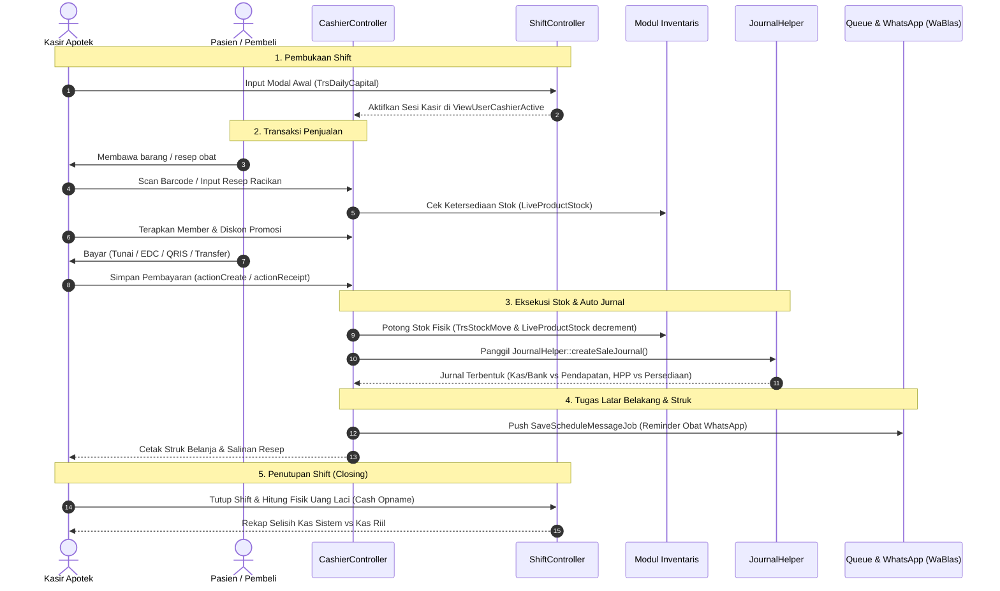

# 01. Modul Penjualan, Kasir & Layanan Resep (POS)

Modul Penjualan dan Kasir (*Point of Sale*) merupakan ujung tombak operasional harian gerai apotek dalam melayani pasien dan pelanggan umum, baik transaksi obat bebas (*Over The Counter / OTC*), obat keras dengan resep dokter, racikan farmasi, layanan swamedikasi apoteker, hingga konsultasi kesehatan.

---

## 📂 Struktur Komponen & Kode Sumber

| Jenis Berkas | Lokasi & Nama Berkas | Tanggung Jawab Utama |
| :--- | :--- | :--- |
| **Controller** | `controllers/trx/CashierController.php` | Controller utama layar kasir POS: pencarian produk instan, penanganan keranjang, kalkulasi diskon, pembayaran multi-metode, penukaran poin, cetak struk, dan retur struk. |
| **Controller** | `controllers/trx/CashierManualController.php` | Antarmuka kasir cadangan (*fallback*) untuk input transaksi manual saat terjadi pemadaman listrik, kendala jaringan, atau migrasi data riwayat. |
| **Controller** | `controllers/trx/ShiftController.php` | Manajemen shift kasir: buka laci kasir, serah terima saldo fisik (*shift handover*), dan validasi kasir aktif. |
| **Controller** | `controllers/trx/DoctorController.php` | Registrasi dokter penulis resep, perhitungan jasa/komisi dokter mitra, dan rekapitulasi lembar resep. |
| **Controller** | `controllers/trx/SwamedicController.php` | Pencatatan layanan swamedikasi apoteker (*counseling log*, keluhan gejala pasien, rekomendasi terapi). |
| **Controller** | `controllers/trx/ClaimRewardController.php` | Manajemen klaim hadiah dan penukaran poin loyalitas pelanggan pada layar kasir. |
| **Model** | `models/TrsSale.php` | Entitas kepala transaksi penjualan (`invoice_number`, `id_branch`, `total_price`, `final_price`, `pay`, `change`, `payment_type`, `id_user_cashier`). |
| **Model** | `models/TrsSaleDetail.php` | Rincian item penjualan (`id_product`, `quantity`, `price`, `discount`, `hpp`, `subtotal`, `is_recipe`, `batch_number`). |
| **Model** | `models/TrsDailyCapital.php` | Pencatatan modal kerja awal kasir per shift. |
| **Model** | `models/TrsReceipt.php` | Header dokumen salinan resep dokter (*copy resep*). |
| **Model** | `models/TrsReceiptService.php` | Biaya jasa non-barang (jasa racik puyer, kapsul, embalase, salinan resep, delivery order). |
| **Views** | `views/layouts/main-cashier.php` | Layout khusus POS kasir tanpa sidebar umum untuk memaksimalkan area kerja kasir dan kecepatan respons keyboard/barcode scanner. |

---

## 🔄 Alur Kerja Siklus Kasir (End-to-End Workflow)

---

## ⚙️ Fitur-Fitur Spesifik Industri Farmasi pada POS

### 1. Penanganan Jasa Resep & Embalase Farmasi
Dalam penjualan obat resep, sistem memisahkan harga obat dengan komponen jasa melalui model `TrsReceiptService`. `JournalHelper::getCoaJasa()` memetakan pendapatan jasa tersebut ke kode akun yang tepat:
* **Jasa Racikan Kapsul:** Masuk ke COA `4.1.3.4`
* **Jasa Racikan Puyer:** Masuk ke COA `4.1.3.5`
* **Jasa Konsultasi Apoteker:** Masuk ke COA `4.1.3.3`
* **Embalase (Plastik Klip/Wadah Salep):** Masuk ke COA `4.1.3.6`
* **Jasa Rujukan Dokter:** Masuk ke COA `4.1.4`

### 2. Layanan Swamedikasi (*Self-Medication Counseling*)
Melalui `SwamedicController`, apoteker mendokumentasikan keluhan pasien (batuk, demam, alergi, nyeri), obat yang disarankan, serta instruksi penggunaan. Data ini terhubung dengan riwayat rekam medis pasien (*Patient Medication Record / PMR*).

### 3. Otomatisasi Jadwal Reminder Konsumsi Obat via WhatsApp
Ketika transaksi kasir menyimpan obat rutin atau antibiotik:
* Sistem mendorong job `SaveScheduleMessageJob` ke dalam antrian `yii\queue`.
* Antrian ini menjadwalkan pesan WhatsApp via gateway `WaBlas` atau `Fonnte` untuk mengingatkan pasien kapan harus meminum obat atau jadwal kontrol/pembelian ulang obat kronis (Hipertensi/Diabetes).

### 4. Retur dan Pembatalan Transaksi Kasir (*Void / Return*)
Jika terjadi kesalahan transaksi atau pembatalan:
* Kasir mengeksekusi aksi retur pada `CashierController::actionRetur`.
* Sistem memanggil `JournalHelper::reverseSaleJournal($modelSale, $returDetails)`.
* Jurnal kas dan piutang dibalik secara otomatis, stok obat dikembalikan ke gudang/rak asal, dan nilai HPP disesuaikan kembali.
