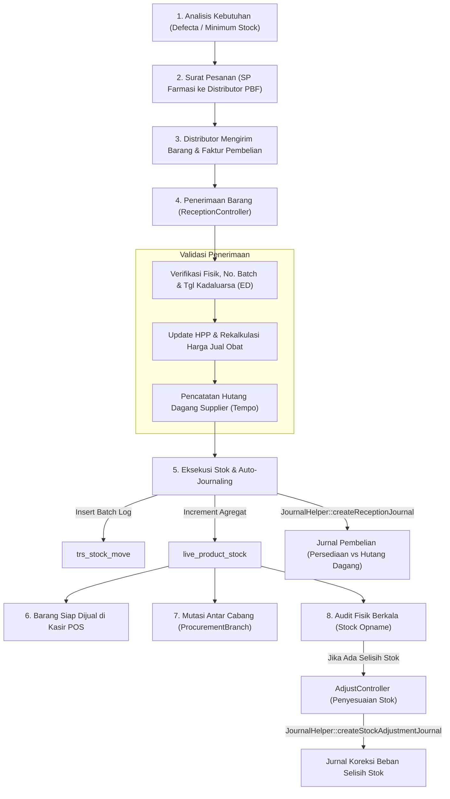

# 02. Modul Pengadaan, Penerimaan & Manajemen Inventaris

Modul Pengadaan dan Inventaris (*Procurement & Supply Chain*) mengelola seluruh rantai pasok obat dan barang dagangan apotek, mulai dari identifikasi stok menipis (*Defecta*), pemesanan ke Pedagang Besar Farmasi (PBF) sesuai regulasi BPOM, penerimaan faktur, pencatatan batch & *expired date*, mutasi stok antar-cabang, hingga stock opname fisik.

---

## 📂 Struktur Komponen & Kode Sumber

| Jenis Berkas | Lokasi & Nama Berkas | Tanggung Jawab Utama |
| :--- | :--- | :--- |
| **Controller** | `controllers/trx/ProcurementController.php` | Pengelolaan Surat Pesanan (SP) ke PBF: SP Reguler, Prekursor, Psikotropika, Narkotika, dan Obat-Obat Tertentu (OOT). |
| **Controller** | `controllers/trx/ProcurementBranchController.php` | Pengadaan antar-cabang (*interbranch order*): permintaan barang dari cabang satelit ke cabang pusat/gudang dan pengiriman barang antar-outlet. |
| **Controller** | `controllers/trx/ReceptionController.php` | Penerimaan barang masuk berdasarkan faktur PBF: input nomor batch, tanggal kadaluarsa (*ED*), validasi harga beli, diskon prinsipal, dan penyesuaian harga jual apotek. |
| **Controller** | `controllers/trx/ReturController.php` | Retur barang ke supplier PBF akibat barang mendekati kadaluarsa (*near-ED*), kemasan rusak, atau ketidaksesuaian faktur. |
| **Controller** | `controllers/trx/StockCardController.php` | Kartu stok terperinci (*Stock Ledger Card*) yang melacak saldo awal, mutasi masuk, mutasi keluar, dan sisa stok per produk. |
| **Controller** | `controllers/trx/StockMoveController.php` | Log pergerakan stok real-time antar gudang, rak penjualan, dan transaksi kasir. |
| **Controller** | `controllers/trx/StockOpnameController.php` | Pelaksanaan audit fisik inventaris (*Stock Opname*), pencocokan jumlah fisik dengan saldo sistem. |
| **Controller** | `controllers/trx/AdjustController.php` | Persetujuan dan eksekusi penyesuaian selisih stok opname (*Stock Adjustment*) ke dalam sistem akuntansi. |
| **Controller** | `controllers/report/DefectaController.php` | Buku defecta digital: peringatan otomatis obat yang mencapai *Minimum Stock Level* / *Buffer Stock*. |
| **Model** | `models/TrsProcurement.php` & `Detail` | Header dan item Surat Pesanan (nomor SP, tanggal SP, supplier tujuan, daftar item dipesan). |
| **Model** | `models/TrsReception.php` & `Detail` | Header dan detail faktur pembelian (nomor faktur, tanggal jatuh tempo hutang, PPN, diskon bertingkat, batch obat). |
| **Model** | `models/LiveProductStock.php` | Snapshot agregat stok produk per kombinasi `(id_branch, id_warehouse, id_rack, id_product)`. |
| **Model** | `models/TrsStockMove.php` | Baris transaksi mutasi fisik obat per lot/batch. |
| **Repository** | `repositories/ReceptionRepository.php` | Validasi kueri penerimaan, deteksi pergerakan stok, dan pembulatan harga jual. |

---

## 🔄 Alur Rantai Pasok Obat (Supply Chain Lifecycle)

---

## ⚙️ Mekanisme Teknis Kunci

### 1. Kepatuhan Regulasi Surat Pesanan (SP) BPOM
Apotek wajib membuat format SP yang berbeda untuk kategori obat yang diawasi ketat. Sistem memiliki template khusus dan penomoran terpisah pada `ProcurementController`:
* **SP Prekursor Farmasi:** Untuk obat flu/batuk yang mengandung Pseudoefedrin atau Efedrin.
* **SP Psikotropika & Narkotika:** Mencantumkan nama Apoteker Pengelola Apotek (APA), nomor SIPA, dan tanda tangan khusus.
* **SP Obat-Obat Tertentu (OOT):** Tramadol, Triheksifenidil, Klorpromazin, Amitriptilin, Haloperidol, dan Dekstrometorfan.

### 2. Arsitektur Dual-Stock (*High Performance vs Granular Traceability*)
Untuk mengantisipasi tingginya volume transaksi kasir dan mutasi inventaris pada jaringan apotek:
* **Tabel `trs_stock_move`:** Berfungsi sebagai *Single Source of Truth*. Setiap mutasi sekecil apapun (penjualan kasir, penerimaan faktur, retur supplier, penyesuaian opname) disimpan sebagai baris baru dengan informasi nomor batch dan tanggal kadaluarsa.
* **Tabel `live_product_stock`:** Berfungsi sebagai *Read-Optimized Cache*. Menyimpan angka total agregat stok per rak dan cabang, sehingga kasir dapat melakukan pencarian ketersediaan barang secara instan tanpa melakukan `SUM()` pada jutaan baris riwayat.
* **Proses Sinkronisasi Cron (`CronController::actionFixing`):**
  Dijalankan oleh cron server setiap 5 menit via console command `php yii cron/fixing`. Script ini mendeteksi jika terjadi selisih antara agregat `live_product_stock` dan histori transaksi `trs_stock_move`, lalu melakukan koreksi otomatis di latar belakang.

### 3. Integrasi Akuntansi Otomatis pada Modul Inventaris
Setiap peristiwa stok yang berdampak pada nilai finansial memicu fungsi otomatis pada `JournalHelper`:

1. **Penerimaan Faktur Pembelian (`createReceptionJournal`):**
   * **[Debit]** Akun Persediaan Barang (COA `1.1.2.x` dipetakan otomatis sesuai jenis produk: Obat, Alkes, Kosmetik, Susu/Nutrisi, dsb.).
   * **[Kredit]** Akun Hutang Dagang Supplier (COA `2.1.1.x`).
2. **Retur Pembelian ke Supplier (`createReturJournal`):**
   * **[Debit]** Akun Hutang Dagang Supplier.
   * **[Kredit]** Akun Persediaan Barang.
3. **Pengiriman Stok Antar Cabang (`createInterbranchSaleJournal`):**
   * Membentuk jurnal piutang/hubungan antar kantor (RAK) antara cabang pengirim dan cabang penerima.
4. **Penyesuaian Selisih Opname Fisik (`createStockAdjustmentJournal`):**
   * Jika stok fisik kurang: **[Debit]** Beban Selisih Stok Opname, **[Kredit]** Persediaan.
   * Jika stok fisik lebih: **[Debit]** Persediaan, **[Kredit]** Pendapatan Selisih Stok Opname.
