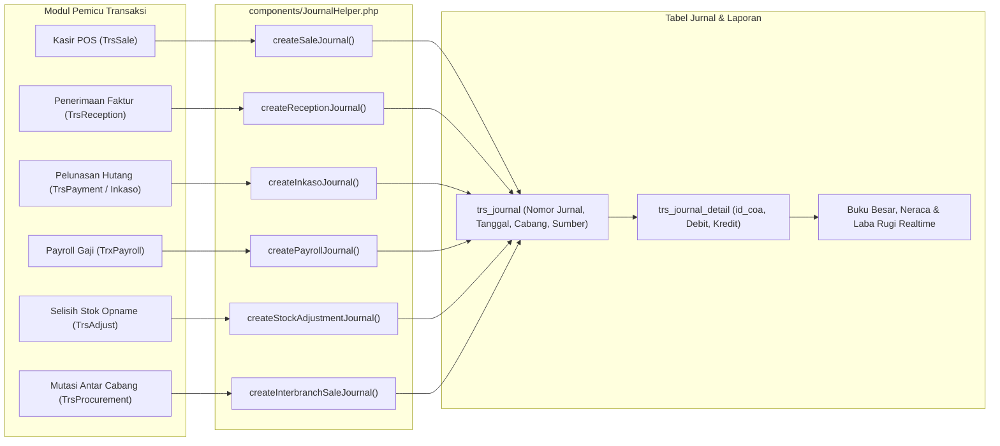

# 03. Modul Keuangan, Kas-Bank & Akuntansi (General Ledger)

Modul Keuangan dan Akuntansi (*Finance & General Ledger*) merupakan fondasi pelaporan finansial SIM AFGINDO. Modul ini menerapkan prinsip akuntansi berpasangan (*double-entry bookkeeping*) yang sepenuhnya terotomatisasi dengan seluruh proses operasional (kasir, pengadaan, logistik, dan penggajian).

---

## 📂 Struktur Komponen & Kode Sumber

| Jenis Berkas | Lokasi & Nama Berkas | Tanggung Jawab Utama |
| :--- | :--- | :--- |
| **Engine Inti** | `components/JournalHelper.php` | Mesin pembukuan otomatis sentral: membentuk nomor jurnal unik, memetakan kategori barang/jasa/bank ke Bagan Akun (COA), serta menyimpan baris Debit dan Kredit yang seimbang. |
| **Controller** | `controllers/trx/CashbankController.php` | Pencatatan mutasi kas dan bank: transfer antar-rekening, setoran omzet kasir ke rekening bank pusat, dan penerimaan non-operasional. |
| **Controller** | `controllers/trx/PettyCashController.php` | Pengelolaan kas kecil (*petty cash*) outlet untuk pengeluaran operasional mendesak (ATK, konsumsi, kebersihan, listrik, fotokopi). |
| **Controller** | `controllers/trx/InkasoController.php` | Modul pelunasan hutang pembelian ke PBF: memotong faktur tempo yang jatuh tempo menggunakan rekening kas/bank apotek. |
| **Controller** | `controllers/trx/CashOpnameController.php` | Audit fisik brankas outlet: mencocokkan jumlah lembaran dan koin fisik dengan saldo buku kas di sistem. |
| **Controller** | `controllers/trx/AccountingController.php` | Manajemen jurnal umum (*General Journal*), jurnal penyesuaian (*Adjustment Journal*), dan koreksi pembukuan oleh staf akuntansi. |
| **Controller** | `controllers/accounting/BudgetController.php` | Perencanaan dan pengawasan anggaran belanja mingguan/bulanan per cabang. |
| **Controller** | `controllers/accounting/CashflowPredictionController.php` | Proyeksi arus kas masa depan berdasarkan histori pendapatan dan jadwal jatuh tempo pembayaran faktur supplier. |
| **Controller** | `controllers/trx/DividenController.php` | Alokasi dan pembagian dividen laba bersih kepada para pemegang saham atau mitra apotek. |
| **Reporting** | `controllers/report/BukuBesarController.php` | Rincian mutasi debit/kredit per akun COA dalam rentang tanggal tertentu. |
| **Reporting** | `controllers/report/NeracaLajurController.php` | Lembar kerja 10/12 kolom (*Trial Balance/Worksheet*) untuk verifikasi saldo sebelum tutup buku. |
| **Reporting** | `controllers/report/LabaRugiController.php` | Laporan Laba Rugi komprehensif (Pendapatan Penjualan, HPP, Laba Kotor, Beban Operasional, Laba Bersih). |
| **Reporting** | `controllers/report/BalanceSheetController.php` | Laporan Posisi Keuangan / Neraca (Aset Lancar, Aset Tetap, Kewajiban Jangka Pendek, Ekuitas Modal). |
| **Reporting** | `controllers/report/CashflowController.php` | Laporan Arus Kas (Aktivitas Operasi, Aktivitas Investasi, Aktivitas Pendanaan). |
| **Model** | `models/MstCoa.php` | Master Bagan Akun hierarkis (Nomor kode akun, nama akun, tipe saldo normal, level induk). |
| **Model** | `models/TrsJournal.php` & `Detail` | Header jurnal (`number`, `date`, `id_branch`, `source`, `note`) dan baris detail (`id_coa`, `debit`, `kredit`). |

---

## 🏛️ Struktur Bagan Akun (Chart of Accounts / COA) Farmasi

Sistem mengadopsi standar penomoran COA hierarkis yang disesuaikan dengan karakteristik rantai farmasi ritel:

```
1.x.x.x - ASET (ASSETS)
  ├── 1.1.x.x - Aset Lancar
  │    ├── 1.1.1.x - Kas & Setara Kas (Kasir, Kas Kecil, Rekening Bank BCA/Mandiri/BRI)
  │    ├── 1.1.2.x - Persediaan Barang Dagang (Dipetakan otomatis per kelompok komoditas)
  │    │    ├── 1.1.2.1  - Persediaan Obat
  │    │    ├── 1.1.2.2  - Persediaan Alat Kesehatan (Alkes)
  │    │    ├── 1.1.2.3  - Persediaan Nutrisi / Susu
  │    │    ├── 1.1.2.4  - Persediaan Herbal
  │    │    ├── 1.1.2.5  - Persediaan Baby Care
  │    │    ├── 1.1.2.6  - Persediaan Kosmetika
  │    │    ├── 1.1.2.7  - Persediaan Vitamin
  │    │    └── 1.1.2.31 s/d 1.1.2.61 - Persediaan Konsinyasi (Konsi)
  │    └── 1.1.3.x - Piutang Usaha & Piutang Asuransi / Resep Instansi
  └── 1.2.x.x - Aset Tetap (Peralatan Farmasi, Komputer Kasir, Kulkas Khusus Obat, Akumulasi Depresiasi)

2.x.x.x - KEWAJIBAN (LIABILITIES)
  ├── 2.1.1.x - Hutang Dagang Supplier (PBF)
  └── 2.1.2.x - Hutang Gaji & Biaya yang Masih Harus Dibayar

3.x.x.x - EKUITAS (EQUITY)
  ├── 3.1.1.x - Modal Disetor Pemilik / Investor
  └── 3.2.1.x - Laba Ditahan & Dividen

4.x.x.x - PENDAPATAN (REVENUE)
  ├── 4.1.1.x - Penjualan Obat Bebas (OTC)
  ├── 4.1.2.x - Penjualan Obat Resep
  ├── 4.1.3.x - Pendapatan Jasa Farmasi (Racikan, Embalase, Konsultasi Apoteker, Delivery)
  └── 4.1.4.x - Pendapatan Jasa Dokter

5.x.x.x - HARGA POKOK PENJUALAN (HPP / COGS)
  └── 5.1.x.x - Beban Pokok Penjualan Obat & Komoditas

6.x.x.x - BEBAN OPERASIONAL (EXPENSES)
  ├── 6.1.1.x - Beban Gaji & Upah Karyawan
  ├── 6.1.2.x - Beban Lembur, SPPD & Tunjangan
  ├── 6.1.3.x - Beban Sewa Bangunan & Utilitas (Listrik, Air, Internet)
  ├── 6.1.4.x - Beban Selisih Stok Opname (Kerusakan / Kehilangan Barang)
  └── 6.1.5.x - Beban Penyusutan Aset Tetap
```

---

## ⚡ Mesin Jurnal Otomatis (`JournalHelper`)

Komponen [`app\components\JournalHelper`](file:///C:/Users/user/Downloads/IT%20SUPPORT/sim.afgindo_19_10_2026/components/JournalHelper.php) adalah jembatan yang menghubungkan seluruh modul ke dalam General Ledger:



### Metode-Metode Kunci `JournalHelper`:
1. **`getCoaPersediaan($id_product_type, $isKonsi)`:** Menentukan akun persediaan aset lancar secara otomatis berdasarkan kategori produk (Obat, Alkes, Herbal, Susu, Kosmetik, dsb.), membedakan stok milik sendiri dengan titipan/konsinyasi.
2. **`getCoaJasa($serviceName)`:** Menganalisis string nama jasa (misal: "Racikan Kapsul", "Konsultasi Apoteker", "Embalase", "Telemedicine") untuk dialokasikan ke nomor akun pendapatan jasa yang sesuai.
3. **`createSaleJournal($modelSale, $modelsSaleDetail)`:** Membukukan transaksi kasir: mendebit Kas/Bank/Piutang, mengkredit Penjualan, mendebit HPP, dan mengkredit Persediaan Produk.
4. **`createReceptionJournal($modelReception)`:** Membukukan faktur pembelian distributor: mendebit Persediaan Produk dan mengkredit Hutang Dagang Supplier.
5. **`createInkasoJournal($modelPayment)`:** Membukukan pembayaran faktur ke distributor: mendebit Hutang Dagang Supplier dan mengkredit rekening Kas/Bank pembayar.
6. **`createPayrollJournal($payrollData)`:** Membukukan penggajian bulanan cabang: mendebit Beban Gaji, Tunjangan, Lembur, dan mengkredit Kas/Hutang Gaji.
