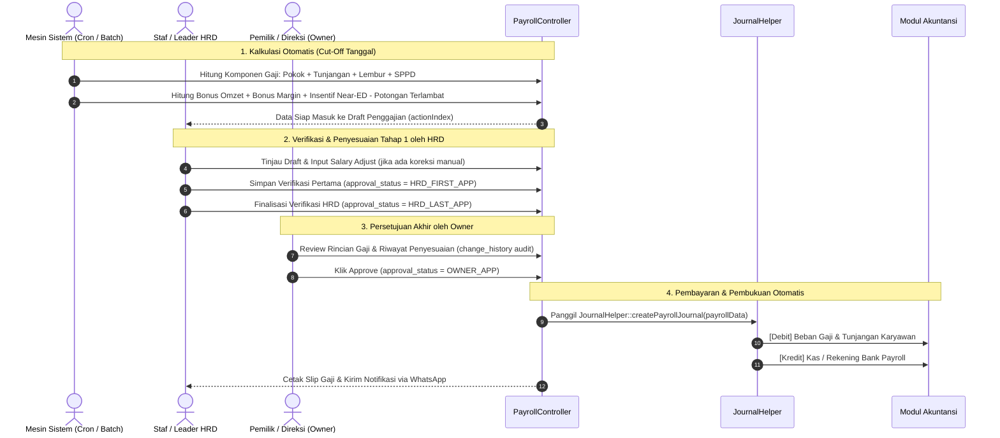

# 04. Modul SDM, Presensi, KPI & Penggajian (Payroll)

Modul Sumber Daya Manusia (*Human Resources Development & Payroll*) mengelola seluruh siklus hidup pegawai apotek dan klinik: rekrutmen, penugasan cabang, penjadwalan shift kerja, kepatuhan izin kefarmasian (STRA/SIPA), audit kepatuhan harian (*checklist*), penilaian kinerja berbasis KPI, hingga alur penggajian bertingkat (*multi-tier payroll approval*) yang terintegrasi langsung ke modul akuntansi.

---

## 📂 Struktur Komponen & Kode Sumber

| Jenis Berkas | Lokasi & Nama Berkas | Tanggung Jawab Utama |
| :--- | :--- | :--- |
| **Controller** | `controllers/hrd/EmployeeController.php` | Pengelolaan data induk pegawai: NIK, nama, cabang penempatan, divisi, jabatan, nomor rekening bank gaji, masa berlaku STRA/SIPA. |
| **Controller** | `controllers/hrd/PayrollController.php` | Mesin penggajian utama: kalkulasi komponen upah, lembur, bonus kinerja, potongan keterlambatan, penyesuaian gaji, verifikasi HRD, persetujuan Owner, dan cetak slip gaji. |
| **Controller** | `controllers/hrd/PermissionController.php` | Manajemen izin, cuti tahunan, sakit, dan Surat Perintah Perjalanan Dinas (SPPD) antar-cabang. |
| **Controller** | `controllers/hrd/ChecklistController.php` | Pengawasan SOP harian cabang: checklist pembukaan apotek, kebersihan rak, dan pencatatan rutin termometer suhu kulkas obat/vaksin. |
| **Controller** | `controllers/hrd/PerformanceController.php` | Evaluasi kinerja periodik berdasarkan indikator KPI (*Key Performance Indicators*) dan budaya kerja. |
| **Controller** | `controllers/hrd/CounselingController.php` | Pencatatan konseling, pembinaan disiplin staf, dan pemberian Surat Peringatan (SP). |
| **Controller** | `controllers/trx/ScheduleController.php` | Penjadwalan jadwal kerja bulanan (*roster* shift pagi, siang, malam) dan izin tukar shift staf. |
| **Controller** | `controllers/trx/JobApplyController.php` | Portal rekrutmen daring: penerimaan berkas lamaran, seleksi berkas, dan tahapan wawancara. |
| **Model** | `models/User.php` / `Account.php` | Entitas akun staf (`user_id`, `username`, `name`, `id_branch`, `id_division`, `id_position`, `status`). |
| **Model** | `models/TrxPayroll.php` & `Draft` | Header dan baris rincian slip gaji pegawai (gaji pokok, tunjangan, insentif, potongan, riwayat revisi). |
| **Model** | `models/TrsPermission.php` & `TrsSppd` | Entitas permohonan izin cuti dan rincian biaya perjalanan dinas/akomodasi staf. |
| **Model** | `models/MstKpi.php` & `TrxKpiTask` | Definisi target indikator kinerja dan pelaporan realisasi tugas bulanan staf. |

---

## 🔄 Alur Persetujuan Gaji Bertingkat (Multi-Tier Payroll Workflow)

Penggajian di SIM AFGINDO menggunakan mekanisme validasi berlapis guna mencegah salah hitung dan memastikan transparansi sebelum dana kas dicairkan:



---

## ⚙️ Komponen & Formula Penggajian Khusus Farmasi

Sistem mengadopsi skema insentif khusus untuk memotivasi staf apotek dalam meningkatkan penjualan dan mencegah kerugian akibat obat kadaluarsa:

### 1. Komponen Penghasilan (Income Components)
* **Gaji Pokok & Tunjangan Jabatan:** Sesuai kontrak posisi (`MstPosition`).
* **Insentif Omzet Cabang (`bonus_omzet`):** Dihitung dari persentase pencapaian target omzet penjualan kotor apotek tempat staf bertugas.
* **Insentif Margin (`bonus_margin`):** Dihitung dari margin laba kotor yang berhasil dihasilkan cabang.
* **Insentif Obat Mendekati Kadaluarsa (`near_ed`):** Bonus khusus bagi staf yang berhasil memprioritaskan penjualan produk yang masa kadaluarsanya tersisa 3-6 bulan guna mencegah retur atau kerugian stok hangus.
* **Insentif Produk Lambat Bergerak (`dead_stock`):** Bonus penjualan atas barang-barang *slow-moving*.
* **Insentif Produk Fokus (`product_specific`):** Komisi penjualan suplemen atau produk prinsipal mitra strategis.
* **Upah Lembur & SPPD:** Akumulasi jam lembur tervalidasi dan penggantian biaya perjalanan dinas antar-outlet.

### 2. Komponen Potongan (Deductions)
* **Potongan Keterlambatan (`late_charge`):** Dihitung otomatis dari log absensi fingerprint/web per menit keterlambatan masuk kerja melewati toleransi jam operasional.
* **Kasbon / Pinjaman Pegawai:** Pemotongan cicilan pinjaman staf.

### 3. Jejak Audit Penyesuaian Gaji (`change_history`)
Setiap kali ada perubahan manual pada nominal gaji staf saat proses approval, sistem secara otomatis merekam histori ke dalam format JSON di kolom `change_history`:
```json
[
  {
    "user_id": 12,
    "user_name": "Staf HRD",
    "salary_adjust": 100000,
    "datetime": "2026-10-25 09:30:00"
  },
  {
    "user_id": 2,
    "user_name": "Direktur Operasional",
    "salary_adjust": 150000,
    "datetime": "2026-10-26 14:15:00"
  }
]
```
Mekanisme ini menjamin kepatuhan audit internal dan mencegah pengubahan nilai upah tanpa izin tertulis.
