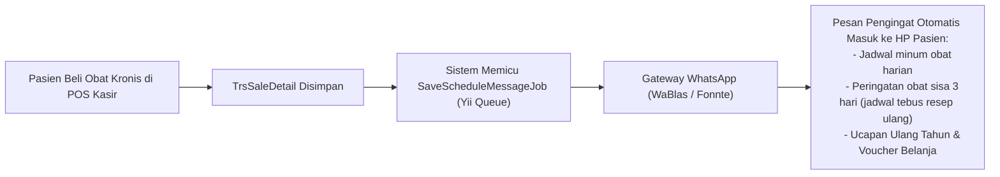

# 05. Modul Pendukung: Aset Tetap, CRM, Portal Investor, LMS & IT AI

Selain modul operasional primer (Kasir, Logistik, Akuntansi, dan HRD), SIM AFGINDO dilengkapi dengan 5 sub-sistem pendukung tingkat lanjut yang menopang efisiensi, retensi pasien, tata kelola modal, dan standardisasi kompetensi tenaga kerja.

---

## 1. 🏢 Modul Manajemen Aset Tetap (Fixed Asset Management)

Modul ini bertanggung jawab atas pelacakan inventaris fisik non-dagang bernilai tinggi milik apotek (kulkas khusus vaksin/obat, rak pajang etalase, pendingin ruangan/AC, genset cadangan, dan unit komputer kasir).

### Komponen & Controller:
* `controllers/asset/AssetController.php` & `DataController.php`: Registrasi master aset, lokasi cabang, penanggung jawab, dan nilai perolehan.
* `controllers/asset/CardController.php`: Pembuatan dan pencetakan kartu fisik aset dilengkapi QR-Code / Barcode label.
* `controllers/asset/ProcurementController.php` & `ApprovalController.php`: Pengajuan pengadaan aset baru dan otorisasi pembelian aset oleh manajemen.
* `controllers/asset/MaintenanceController.php`: Log jadwal servis berkala, perbaikan darurat, dan biaya perawatan aset.
* `controllers/asset/OpnameController.php`: Sensus fisik tahunan untuk memverifikasi keberadaan dan kondisi kelayakan aset.
* `controllers/report/AssetAccountingController.php`: Rekapitulasi penyusutan dan nilai buku aset.

### Skema Penyusutan Otomatis (Depreciation):
Sistem menggunakan metode garis lurus (*Straight-Line Depreciation*):
$$\text{Beban Penyusutan Bulanan} = \frac{\text{Harga Perolehan} - \text{Nilai Residu}}{\text{Masa Manfaat (Bulan)}}$$
Setiap pergantian periode buku, penyusutan dibukukan ke jurnal:
* **[Debit]** Beban Penyusutan Aset Tetap (`6.1.5.x`)
* **[Kredit]** Akumulasi Penyusutan Aset Tetap (`1.2.x.x`)

---

## 2. 📱 Modul CRM & Retensi Pasien via WhatsApp Gateway

Modul *Customer Relationship Management* berfokus pada loyalitas pelanggan, rekam kepatuhan minum obat pasien (*Patient Medication Record / PMR*), dan otomasi komunikasi pesan instan.

### Komponen & Integrasi:
* `controllers/crm/ReminderController.php`: Manajemen antrian pengingat minum obat pasien rawat jalan dan obat rutin.
* `controllers/crm/RetentionMemberController.php`: Analisis churn member (pelanggan yang tidak kembali belanja dalam 30/60/90 hari) dan penawaran voucher promo penarik kembali.
* `controllers/master/MemberController.php` & `LoyaltyPointController.php`: Master keanggotaan, tingkatan member (*Silver, Gold, Platinum*), dan rasio konversi belanja ke poin reward.
* `components/WaBlas.php` & `components/Fonnte.php`: Integrasi REST API gateway WhatsApp untuk pengiriman pesan otomatis.

---

## 3. 💼 Modul Portal Investor & Kemitraan (Investor Dashboard)

Dirancang khusus bagi para pemilik modal (*investor*) dan mitra bagi hasil yang mendanai pembukaan gerai apotek, tanpa memberikan akses ke fungsi teknis kasir atau backoffice.

### Komponen & Layout:
* `views/layouts/investor.php`: Tata letak antarmuka eksklusif, bersih, dan modern yang terisolasi dari menu operasional staf.
* `controllers/investor/DashboardController.php`: Visualisasi grafik KPI outlet: tren omzet harian, margin kotor, biaya operasional cabang, dan laba bersih berjalan.
* `controllers/direktori/InvestorAccessCodeController.php`: Pengelolaan kode akses otentikasi unik (*Investor PIN / Access Code*) untuk mengamankan data kepemilikan saham cabang.
* `controllers/direktori/InvestorDocumentController.php`: Repositori surat perjanjian kerja sama legal, akta notaris kemitraan, dan laporan keuangan auditan yang dapat diunduh investor dalam format PDF.
* `controllers/trx/DividenController.php`: Kalkulasi dan histori transfer pencairan dividen berkala kepada masing-masing mitra pemilik saham cabang.

---

## 4. 🎓 Modul LMS (*Learning Management System*) & Pelatihan Staf

Menjamin standardisasi kompetensi tenaga kefarmasian (Apoteker, Tenaga Teknis Kefarmasian / TTK, Kasir) di seluruh jaringan apotek melalui modul e-learning internal.

### Komponen & Model:
* `controllers/LmsCourseController.php` & `LmsCoursePartController.php`: Pengelolaan silabus pelatihan, video materi edukasi kefarmasian, dan modul SOP pelayanan.
* `controllers/LmsQuizController.php` & `LmsQuizQuestionController.php`: Bank soal kuis kompetensi (pilihan ganda, esai) dengan batas waktu pengerjaan.
* `controllers/LmsClassController.php` & `LmsClassMemberController.php`: Pengelompokan kelas onboarding staf baru per angkatan atau cabang.
* `controllers/LmsTeacherController.php`: Penugasan instruktur/apoteker senior sebagai penguji dan penilai.
* `controllers/LmsLaporanController.php`: Rekapitulasi nilai kelulusan, skor pemahaman SOP, dan riwayat sertifikasi staf.

---

## 5. 🤖 Modul IT & Asisten AI Persona (Internal Artificial Intelligence)

Modul mutakhir pada direktori `controllers/it/` yang mengintegrasikan kapabilitas kecerdasan buatan ke dalam alur kerja apotek:

### Komponen & Database:
* `controllers/it/AiController.php`: Endpoint interaksi chat interaktif untuk staf internal.
* `controllers/it/AuditPembelianController.php`: Algoritma audit anomali pembelian: mendeteksi lonjakan harga beli yang tidak wajar dari distributor tertentu atau indikasi pemborosan stok.
* `models/MstAiPersona.php`: Konfigurasi karakter kepribadian asisten AI (misal: "Konsultan Farmakologi Klinis", "Asisten SOP Apotek", "Analis Keuangan Gerai").
* `models/TrsAiChatSession.php` & `TrsAiChatLog.php`: Penyimpanan riwayat percakapan konsultasi obat, interaksi antar-obat, atau pertanyaan prosedur internal oleh pegawai apotek.
