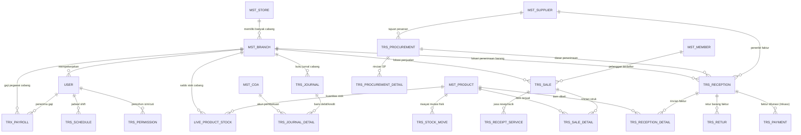

# 06. Kamus Data (Data Dictionary) & Skema Relasi Antar Tabel

Dokumen ini mendokumentasikan skema basis data utama, relasi kunci (*Foreign Keys*), serta aturan integritas data (*Referential Integrity*) yang mendasari sistem ERP **SIM AFGINDO**.

---

## 🗺️ Diagram Hubungan Entitas Utama (Core ERD)

---

## 📋 Kamus Tabel Master (Master Entities)

### 1. `mst_branch` (Master Outlet / Cabang Apotek)
* **Deskripsi:** Menyimpan data cabang jaringan apotek/klinik.
* **Kolom Kunci:**
  * `id_branch` (INT, PK, Auto Increment) — Pengenal unik cabang.
  * `id_store` (INT, FK ➔ `mst_store.id_store`) — Induk badan usaha/PT/CV.
  * `name` (VARCHAR) — Nama gerai (misal: "Apotek Afgindo Cabang Bedahlawak").
  * `address`, `phone`, `email` (VARCHAR) — Kontak dan legalitas cabang.
  * `logo` (VARCHAR) — File gambar logo untuk header struk dan faktur.

### 2. `mst_product` (Master Obat & Komoditas Dagang)
* **Deskripsi:** Katalog barang, obat, alkes, kosmetik, dan barang konsinyasi.
* **Kolom Kunci:**
  * `id_product` (INT, PK, Auto Increment) — Pengenal unik produk.
  * `code` / `barcode` (VARCHAR, Index) — Kode SKU / Barcode pemindai kasir.
  * `name` (VARCHAR, Index) — Nama dagang obat (misal: "Paracetamol 500mg").
  * `id_product_type` (INT, Index) — Klasifikasi tipe barang (Obat, Alkes, Herbal, Susu, Kosmetika).
  * `id_sediaan` (INT, FK) — Bentuk sediaan (Tablet, Sirup, Salep, Kapsul, Injeksi).
  * `id_drug_category` (INT, FK) — Golongan obat (Bebas, Bebas Terbatas, Keras, Narkotika, Psikotropika, Prekursor).
  * `purchase_price` (DECIMAL) — HPP standar / harga beli rata-rata.
  * `selling_price` (DECIMAL) — Harga jual dasar apotek.

### 3. `mst_coa` (Chart of Accounts / Bagan Akun Akuntansi)
* **Deskripsi:** Struktur rekening pembukuan *General Ledger*.
* **Kolom Kunci:**
  * `id_coa` (INT, PK, Auto Increment) — Pengenal unik akun.
  * `code` (VARCHAR, Unique, Index) — Kode rekening (misal: `1.1.1.1` Kas, `1.1.2.1` Persediaan Obat, `4.1.1.1` Penjualan).
  * `name` (VARCHAR) — Nama akun.
  * `parent_id` (INT, Nullable, FK ➔ `mst_coa.id_coa`) — Akun induk hierarki.
  * `normal_balance` (ENUM: `D`, `K`) — Saldo normal (Debit atau Kredit).

### 4. `user` / `account` (Akun Pengguna Sistem)
* **Deskripsi:** Pengguna terautentikasi (Kasir, Apoteker, HRD, Akuntan, Owner, Superadmin).
* **Kolom Kunci:**
  * `user_id` (INT, PK, Auto Increment) — Pengenal staf.
  * `username` (VARCHAR, Unique) — ID Login.
  * `auth_key`, `password_hash` (VARCHAR) — Kredensial keamanan Yii2.
  * `id_branch` (INT, FK ➔ `mst_branch.id_branch`) — Penugasan cabang basis.
  * `id_division` (INT, FK ➔ `mst_division.id_division`) — Departemen/Divisi staf.
  * `id_position` (INT, FK ➔ `mst_position.id_position`) — Jabatan struktural.

---

## 💳 Kamus Tabel Transaksi (Transaction Entities)

### 1. `trs_sale` & `trs_sale_detail` (Transaksi Kasir POS)
* **`trs_sale` (Header):**
  * `id_sale` (INT, PK) — ID transaksi kasir.
  * `invoice_number` (VARCHAR, Unique, Index) — No faktur kasir (format: `INV/CBG/TGL/NOMOR`).
  * `id_branch` (INT, FK) — Cabang tempat kasir bertransaksi.
  * `total_price` (DECIMAL) — Total belanja sebelum diskon.
  * `discount`, `final_price` (DECIMAL) — Nilai diskon dan tagihan akhir.
  * `pay`, `change` (DECIMAL) — Uang yang diserahkan dan kembalian.
  * `payment_type` (TINYINT) — 1: Tunai, 2: EDC/Debit, 3: Transfer, 4: QRIS, 5: Piutang.
  * `id_user_cashier` (INT, FK ➔ `user.user_id`) — Kasir yang bertugas.
* **`trs_sale_detail` (Rincian Item):**
  * `id_sale_detail` (INT, PK) — ID rincian item.
  * `id_sale` (INT, FK ➔ `trs_sale.id_sale`) — Relasi ke header faktur.
  * `id_product` (INT, FK ➔ `mst_product.id_product`) — Produk terjual.
  * `quantity` (DECIMAL) — Jumlah barang terjual.
  * `price`, `hpp` (DECIMAL) — Harga jual satuan dan harga modal (HPP).
  * `subtotal` (DECIMAL) — `(quantity * price) - discount`.
  * `is_recipe` (TINYINT) — Flag penanda apakah barang merupakan resep dokter.

### 2. `trs_reception` & `trs_reception_detail` (Penerimaan Faktur Pembelian)
* **`trs_reception` (Header):**
  * `id_reception` (INT, PK) — ID penerimaan barang.
  * `invoice` (VARCHAR, Index) — Nomor faktur asli dari distributor PBF.
  * `id_branch` (INT, FK) — Cabang penerima barang.
  * `id_supplier` (INT, FK ➔ `mst_supplier.id_supplier`) — PBF penerbit faktur.
  * `reception_date` (DATE) — Tanggal fisik barang diterima.
  * `due_date` (DATE, Index) — Tanggal jatuh tempo pembayaran hutang dagang.
  * `total_purchase_price` (DECIMAL) — Total nominal kewajiban hutang.
* **`trs_reception_detail` (Rincian Item):**
  * `id_reception_detail` (INT, PK) — ID item diterima.
  * `id_reception` (INT, FK) — Relasi ke header penerimaan.
  * `id_product` (INT, FK) — Produk yang diterima.
  * `batch_number` (VARCHAR, Index) — Nomor batch resmi pabrikan.
  * `expired_date` (DATE, Index) — Tanggal kadaluarsa obat.
  * `quantity` (DECIMAL) — Jumlah fisik diterima.
  * `purchase_price` (DECIMAL) — Harga beli per satuan setelah diskon PBF.

### 3. `live_product_stock` vs `trs_stock_move` (Arsitektur Persediaan)
* **`live_product_stock` (Snapshot Saldo Cepat):**
  * `id_branch`, `id_warehouse`, `id_rack`, `id_product` (Composite PK / Unique Index)
  * `total` (DECIMAL) — Angka stok terkini untuk kueri cepat kasir POS.
* **`trs_stock_move` (Buku Mutasi Batch):**
  * `id_stock_move` (INT, PK) — Pengenal unik pergerakan.
  * `id_product` (INT, FK) — Produk yang berpindah.
  * `id_loc_from`, `id_loc_to` (INT) — Asal dan tujuan mutasi (Rak, Gudang, atau Transaksi).
  * `total` (DECIMAL) — Kuantitas mutasi (positif jika masuk, negatif jika keluar).
  * `created_at` (DATETIME, Index) — Timestamp audit mutasi.

### 4. `trs_journal` & `trs_journal_detail` (General Ledger)
* **`trs_journal` (Header):**
  * `id_journal` (INT, PK) — ID Jurnal.
  * `number` (VARCHAR, Unique, Index) — Nomor jurnal unik (`JU-SALE-...`, `JU-RECP-...`, `JU-PAYR-...`).
  * `date` (DATE, Index) — Tanggal transaksi pembukuan.
  * `id_branch` (INT, FK) — Cabang pemilik transaksi.
  * `source` (VARCHAR) — Entitas sumber (misal: `sale:1024`, `reception:450`, `payroll:78`).
* **`trs_journal_detail` (Baris Pembukuan):**
  * `id_journal_detail` (INT, PK) — ID baris jurnal.
  * `id_journal` (INT, FK ➔ `trs_journal.id_journal`) — Header jurnal.
  * `id_coa` (INT, FK ➔ `mst_coa.id_coa`) — Rekening akuntansi yang dipengaruhi.
  * `debit` (DECIMAL, Default 0) — Nominal pada sisi Debit.
  * `kredit` (DECIMAL, Default 0) — Nominal pada sisi Kredit.

### 5. `trx_payroll` (Penggajian Karyawan)
* **Kolom Kunci:**
  * `id_payroll` (INT, PK) — ID penggajian.
  * `id_branch` (INT, FK) — Cabang penggajian.
  * `id_employee` (INT, FK ➔ `user.user_id`) — Staf penerima gaji.
  * `date_payment` (DATE) — Tanggal transfer pembayaran upah.
  * `basic_salary`, `position_allowance` (DECIMAL) — Gaji pokok dan tunjangan jabatan.
  * `bonus_omzet`, `bonus_margin`, `near_ed`, `dead_stock` (DECIMAL) — Insentif kinerja farmasi.
  * `overtime`, `sppd` (DECIMAL) — Upah lembur dan uang saku perjalanan dinas.
  * `late_charge` (DECIMAL) — Potongan denda keterlambatan absensi.
  * `salary_adjust` (DECIMAL) — Penyesuaian gaji manual oleh HRD/Owner.
  * `approval_status` (VARCHAR) — `HRD_FIRST_APP`, `HRD_LAST_APP`, `OWNER_APP`.
  * `change_history` (JSON / TEXT) — Jejak audit riwayat perubahan nominal penyesuaian upah.

---

## 🔒 Konvensi Integritas & Indeks Performa

1. **Composite Unique Index:**
   * `live_product_stock`: `UNIQUE(id_branch, id_warehouse, id_rack, id_product)` guna mencegah redundansi pencatatan saldo rak yang sama.
2. **Kueri Tanggal & Rentang Waktu:**
   * Kolom tanggal transaksi (`trs_sale.created_at`, `trs_reception.due_date`, `trs_journal.date`) selalu diberi indeks tunggal untuk mengoptimalkan pembacaan laporan keuangan bulanan dan tahunan.
3. **Pemisahan Transaksi Aktif & Riwayat Soft Delete:**
   * Entitas penting mengimplementasikan kolom `deleted_at` atau status aktif (`Helper::STAT_ACTIVE`) untuk menjaga jejak audit histori pembukuan dan perpajakan tanpa menghapus data secara fisik dari disk (*No Hard Delete*).
