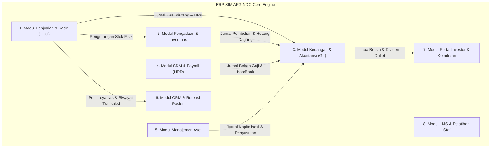
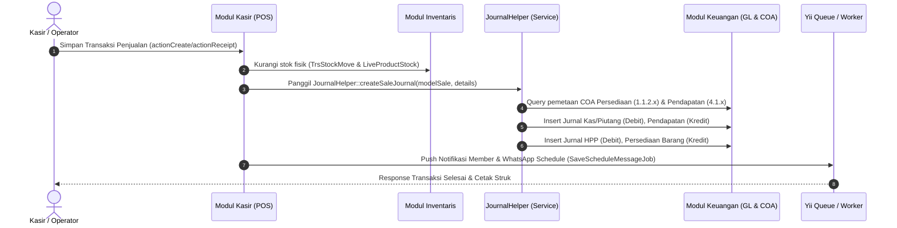
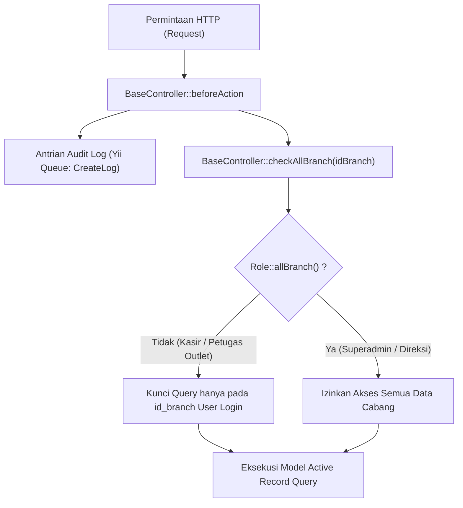

# Dokumentasi Arsitektur Tingkat Tinggi (High-Level Architecture) - SIM AFGINDO ERP

> [!NOTE]
> **SIM AFGINDO** (*Sistem Informasi Manajemen Afgindo*) merupakan sistem ERP (*Enterprise Resource Planning*) komprehensif berbasis **Yii 2 Framework (PHP 7.4/8.x)** yang dirancang untuk rantai operasional ritel farmasi (jaringan apotek & klinik kesehatan) dengan dukungan multi-cabang (*multi-branch/multi-outlet*), POS real-time, manajemen persediaan otomatis, penggajian terintegrasi, hingga pencatatan akuntansi berbasis *double-entry* secara otomatis.

---

## 1. Ikhtisar & Tumpukan Teknologi (Technology Stack)

```
+------------------------------------------------------------------------------------+
|                                    PRESENTATION                                    |
|   Bootstrap 4 | AdminLTE 3 | Kartik GridView/Export | DynamicForms | Chart.js      |
+------------------------------------------------------------------------------------+
|                               APPLICATION & ROUTING                                |
|   Yii 2 Basic Template (Sub-Namespace Controller Pattern)                          |
|   RBAC (mdmsoft/yii2-admin) | AuthManager DbManager | BaseController Isolation     |
+------------------------------------------------------------------------------------+
|                            BUSINESS LOGIC & INTEGRATION                            |
|   JournalHelper (Central Auto-Journaling) | DBHelper | ExportHelper                |
|   Fonnte / WaBlas (WhatsApp Gateway) | Yii Queue (File/Redis Worker)               |
+------------------------------------------------------------------------------------+
|                                    PERSISTENCE                                     |
|   MySQL / MariaDB (InnoDB, Foreign Keys, Stored Views) | Redis (Cache & Session)   |
+------------------------------------------------------------------------------------+
```

* **Backend Framework:** [Yii 2 Framework](https://www.yiiframework.com/) (menggunakan varian arsitektur dasar dengan modularisasi controller sub-namespace).
* **Database & ORM:** MySQL / MariaDB via Yii Active Record & Query Builder.
* **Access Control & Keamanan:** Role-Based Access Control via [mdmsoft/yii2-admin](config/web.php#L22-L37) dengan tabel `auth_assignment`, `auth_item`, `auth_item_child`, dan `auth_rule`.
* **Antrian & Background Tasks:** `yii2-queue` (`yii\queue\file\Queue` / Redis) untuk task asinkron seperti pembaruan live stock, audit log, dan broadcast WhatsApp.
* **Integrasi Eksternal:** WhatsApp Gateway ([WaBlas.php](components/WaBlas.php) dan [Fonnte.php](components/Fonnte.php)), REST API ([modules/rest](modules/rest)).

---

## 2. Analisis Struktur Direktori Proyek

Secara fisik, proyek ini mengadopsi struktur direktori Yii 2 yang dikelompokkan berdasarkan domain fungsional:

| Direktori Utama | Peran Arsitektur | Keterangan & Sub-komponen |
| :--- | :--- | :--- |
| `config/` | Konfigurasi Aplikasi | `web.php`, `db.php`, `params.php`. Mengatur komponen DB, Cache, RBAC, Formatter Rupiah, dan Service Queue. |
| `controllers/` | Controller & Routing Bisnis | Menggunakan sub-folder per domain:<br>• `trx/` (Transaksi: Kasir, Pengadaan, Penerimaan, Retur, Opname)<br>• `accounting/` (Budgeting, Cashflow, Evaluasi)<br>• `hrd/` (Karyawan, Payroll, Shift, Cuti/SPPD, KPI)<br>• `asset/` (Pengadaan, Opname, Depresiasi Aset)<br>• `crm/` (Reminder & Retensi Member)<br>• `master/` (Master Produk, Supplier, COA, Kategori, Cabang)<br>• `report/` (Laporan Akuntansi, Neraca, Penjualan, Stok)<br>• `investor/`, `it/`, `api/`, `json/` |
| `models/` | Lapisan Data & Entitas Bisnis | Berisi Active Record models. Dibagi menjadi entitas master (`Mst*`), transaksi (`Trs*`), dan sub-domain (`models/asset/`, `models/analisis_data/`, `models/master/`, `models/trx/`). |
| `components/` | Engine & Shared Services | Komponen inti penunjang logika lintas modul:<br>• `JournalHelper.php` (Auto-journaling engine)<br>• `DBHelper.php` (Query helper & live stock aggregator)<br>• `WaBlas.php` & `Fonnte.php` (Gateway notifikasi) |
| `helpers/` | Helper Fungsional | `Role.php` (Otorisasi multi-cabang & perizinan role), `ChartHelper.php`. |
| `repositories/` | Abstraksi Query Transaksi | `ReceptionRepository.php` (Validasi penerimaan dan pergerakan stok). |
| `views/` | Antarmuka Pengguna | Layout khusus: `main-cashier.php` (tampilan kasir POS fullscreen), `investor.php`, `career.php`, serta sub-folder view yang memetakan controller. |
| `commands/` | CLI & Scheduled Tasks | `CronController.php` (Cron sinkronisasi stock, live product fixing tiap 5 menit). |
| `modules/rest/` | Modul Layanan API | Endpoint RESTful untuk sinkronisasi client mobile/eksternal. |

---

## 3. Modul-Modul Utama Sistem ERP

Sistem dibagi menjadi 8 modul domain utama yang saling berkolaborasi:



### 3.1. Modul Penjualan & Kasir (*Point of Sale / POS*)
* **Controller Inti:** `controllers/trx/CashierController.php`, `CashierManualController.php`, `DoctorController.php`, `SwamedicController.php`, `ShiftController.php`.
* **Model Kunci:** `TrsSale`, `TrsSaleDetail`, `TrsDailyCapital`, `TrsReceipt`, `TrsReceiptService`.
* **Fungsi Utama:**
  * Transaksi kasir ritel langsung (*over the counter*), layanan resep dokter, dan swamedikasi apoteker.
  * Manajemen kasir harian: modal kasir awal (*Daily Capital*), pergantian shift (*Shift*), dan rekapitulasi cash drawer saat *closing*.
  * Integrasi promosi bundling, diskon bertingkat, dan penukaran poin loyalitas member.
  * Fitur cetak struk kasir, invoice, dan salinan resep digital.

### 3.2. Modul Pengadaan & Inventaris (*Procurement & Stock Management*)
* **Controller Inti:** `controllers/trx/ProcurementController.php`, `controllers/trx/ReceptionController.php`, `controllers/trx/ProcurementBranchController.php`, `controllers/trx/ReturController.php`, `controllers/trx/StockOpnameController.php`, `controllers/trx/AdjustController.php`.
* **Model Kunci:** `TrsProcurement`, `TrsReception`, `TrsRetur`, `LiveProductStock`, `TrsStockMove`, `TrsProductStock`, `TrsStockOpname`.
* **Fungsi Utama:**
  * **Pengadaan (SP/PO):** Pembuatan Surat Pesanan reguler, SP Prekursor/OOT/Narkotika/Psikotropika, dan pengadaan antar-cabang (*interbranch request*).
  * **Penerimaan Barang (*Reception*):** Input faktur supplier, pencatatan batch number, tanggal kadaluarsa (*expiry date*), dan penentuan HPP / harga jual baru.
  * **Arsitektur Dual Stok (*Live vs Ledger*):** Menggabungkan pergerakan batch fisik (`TrsStockMove`) dengan cache total cepat (`LiveProductStock`) untuk performa tinggi pada kasir.
  * **Stock Opname & Sampling:** Audit stok fisik berkala dengan mekanisme persetujuan penyesuaian selisih (*Stock Adjustment*).

### 3.3. Modul Keuangan & Akuntansi (*Finance & Double-Entry Accounting*)
* **Controller Inti:** `controllers/accounting/BudgetController.php`, `controllers/trx/CashbankController.php`, `controllers/trx/InkasoController.php`, `controllers/trx/PettyCashController.php`, `controllers/report/JournalController.php`, `controllers/report/BalanceSheetController.php`, `controllers/report/LabaRugiController.php`.
* **Model Kunci:** `MstCoa`, `TrsJournal`, `TrsJournalDetail`, `TrsCashbank`, `TrsPayment`, `TrsPettyCash`.
* **Fungsi Utama:**
  * **Bagan Akun (Chart of Accounts / COA):** Pengelompokan akun hierarkis (Aset, Kewajiban, Ekuitas, Pendapatan, HPP, Beban Operasional).
  * **Engine Jurnal Otomatis:** Dipusatkan pada `components/JournalHelper.php`. Modul transaksi tidak perlu menyusun SQL jurnal manual; cukup memanggil fungsi pembantu terkait.
  * **Inkaso (Pelunasan Hutang):** Pencatatan pembayaran faktur tempo supplier via kas/bank dengan pemotongan saldo hutang dagang.
  * **Laporan Keuangan Standar:** Buku Besar (*General Ledger*), Neraca Lajur (*Trial Balance*), Laporan Laba Rugi Cabang/Konsolidasi, Neraca (*Balance Sheet*), dan Arus Kas (*Cash Flow*).

### 3.4. Modul SDM & Penggajian (*HRD & Multi-Tier Payroll*)
* **Controller Inti:** `controllers/hrd/EmployeeController.php`, `controllers/hrd/PayrollController.php`, `controllers/hrd/PermissionController.php`, `PerformanceController.php`, `ChecklistController.php`.
* **Model Kunci:** `User`, `MstPosition`, `MstDivision`, `TrxPayroll`, `TrsPermission`, `TrsAttitudeAssessment`, `MstKpi`, `TrxKpiTask`.
* **Fungsi Utama:**
  * Master pegawai, penugasan cabang, divisi, dan riwayat dokumen legalitas kefarmasian (STRA/SIPA).
  * Presensi, manajemen shift, pengajuan cuti, izin sakit, dan SPPD (Surat Perintah Perjalanan Dinas).
  * **Alur Persetujuan Gaji (*Multi-Tier Payroll Workflow*):** Perhitungan komponen gaji pokok, lembur, insentif margin/omzet, near-ED bonus, potongan keterlambatan, penyesuaian (*salary adjustment*), validasi HRD (*HRD Verification*), hingga *Owner Approval*.
  * Otomatisasi pembentukan beban gaji ke modul Akuntansi saat pembayaran disetujui.

### 3.5. Modul Manajemen Aset (*Fixed Asset Management*)
* **Controller Inti:** `controllers/asset/AssetController.php`, `MaintenanceController.php`, `OpnameController.php`, `ApprovalController.php`.
* **Model Kunci:** `models/asset/MstAsset.php`, `MstAssetCategoryType.php`, `TrsAssetDepreciation.php`, `TrsAssetMaintenance.php`, `TrsAssetOpname.php`.
* **Fungsi Utama:**
  * Inventarisasi aset fisik apotek (meja racik, kulkas obat khusus, AC, genset, komputer kasir).
  * Penomoran barcode/QR code label aset.
  * Perhitungan jadwal dan jurnal beban depresiasi aset secara otomatis berdasarkan masa manfaat.
  * Pemeliharaan berkala (*maintenance log*) dan opname fisik aset per cabang.

### 3.6. Modul CRM & Retensi Pelanggan
* **Controller Inti:** `controllers/crm/ReminderController.php`, `RetentionMemberController.php`, `controllers/master/MemberController.php`.
* **Model & Komponen Kunci:** `MstMember`, `MstLoyaltyPoint`, `TrsLoyaltyPointClaim`, `components/WaBlas.php`, `components/Fonnte.php`.
* **Fungsi Utama:**
  * Segmentasi pelanggan (member reguler vs kronis).
  * Layanan *PMR (Patient Medication Record)* dan pengingat konsumsi obat / pembelian ulang obat kronis (Hipertensi, Diabetes) via WhatsApp API.
  * Program reward poin kasir yang dapat ditukarkan hadiah/diskon transaksi berikutnya.

### 3.7. Modul Portal Investor & Kemitraan
* **Controller Inti:** `controllers/investor/DashboardController.php`, `InvestorController.php`, `controllers/trx/DividenController.php`.
* **Model Kunci:** `MstInvestorBranch`, `MstInvestorAccessCode`, `MstInvestorDocument`.
* **Fungsi Utama:**
  * Portal transparansi performa keuangan outlet khusus pemegang saham/investor tanpa hak akses ke modul teknis operasional.
  * Dashboard grafik laba bersih, omzet harian/bulanan, dan pembagian dividen berkala.

### 3.8. Modul LMS (*Learning Management System*) & Pelatihan Staf
* **Controller Inti:** `LmsCourseController.php`, `LmsQuizController.php`, `LmsClassController.php`, `ElearningController.php`.
* **Model Kunci:** `LmsCourse`, `LmsQuiz`, `LmsQuizQuestion`, `LmsClassMember`, `LmsUserProgress`.
* **Fungsi Utama:**
  * Pelatihan internal staf apotek/klinik mengenai Standar Operasional Prosedur (SOP), pengetahuan produk obat baru, dan layanan kefarmasian.
  * Pelaksanaan kuis uji kompetensi dan sertifikasi staf secara daring di dalam sistem.

---

## 4. Alur Komunikasi Antar Modul (Inter-Module Communication)

Komunikasi antar modul di dalam SIM AFGINDO diorganisasi melalui 3 mekanisme utama:

1. **Jembatan Layanan Tersentralisasi (*Centralized Service Helper - Event-Driven Style*)**
2. **Entitas Data Bersama (*Shared Relational Entities & Active Record*)**
3. **Pemrosesan Asinkron & Antrian Latar Belakang (*Message Queue & Crons*)**



### 4.1. Pola Integrasi Transaksi ke Jurnal Akuntansi (`JournalHelper`)

`components/JournalHelper.php` bertindak sebagai *Integration Hub* utama. Modul transaksi tidak pernah melakukan manipulasi baris jurnal secara langsung, melainkan mengeksekusi kontrak fungsi terstandar:

```
+--------------------------+------------------------------------------------------+------------------------------------------------+
| Modul Pemanggil          | Metode Integrasi di JournalHelper                    | Pengaruh Akuntansi (Double-Entry Posting)     |
+--------------------------+------------------------------------------------------+------------------------------------------------+
| Kasir (Penjualan)        | JournalHelper::createSaleJournal(...)                | [D] Kas / Piutang                              |
|                          |                                                      |   [K] Pendapatan Penjualan Obat/Jasa           |
|                          |                                                      | [D] HPP (Beban Pokok Penjualan)                |
|                          |                                                      |   [K] Persediaan Obat (sesuai tipe produk)     |
+--------------------------+------------------------------------------------------+------------------------------------------------+
| Kasir (Retur Penjualan)  | JournalHelper::reverseSaleJournal(...)               | [D] Retur Penjualan & Persediaan               |
|                          |                                                      |   [K] Kas/Piutang & HPP                        |
+--------------------------+------------------------------------------------------+------------------------------------------------+
| Pengadaan (Penerimaan)   | JournalHelper::createReceptionJournal(...)           | [D] Persediaan Barang Masuk / Titipan          |
|                          |                                                      |   [K] Hutang Dagang Supplier (TrsReception)    |
+--------------------------+------------------------------------------------------+------------------------------------------------+
| Pengadaan (Retur Beli)   | JournalHelper::createReturJournal(...)               | [D] Hutang Dagang Supplier                     |
|                          |                                                      |   [K] Persediaan Barang                        |
+--------------------------+------------------------------------------------------+------------------------------------------------+
| Keuangan (Inkaso Faktur) | JournalHelper::createInkasoJournal(...)              | [D] Hutang Dagang Supplier                     |
|                          |                                                      |   [K] Kas / Rekening Bank Terpilih             |
+--------------------------+------------------------------------------------------+------------------------------------------------+
| Mutasi Cabang (Inter)    | JournalHelper::createInterbranchSaleJournal(...)     | [D] Rekening Antar-Kantor Cabang Tujuan        |
|                          |                                                      |   [K] Persediaan Cabang Asal                   |
+--------------------------+------------------------------------------------------+------------------------------------------------+
| Inventaris (Selisih SO)  | JournalHelper::createStockAdjustmentJournal(...)     | [D/K] Beban Selisih Stok Opname                |
|                          |                                                      |   [K/D] Akun Persediaan Produk                 |
+--------------------------+------------------------------------------------------+------------------------------------------------+
| HRD (Penggajian)         | JournalHelper::createPayrollJournal(...)             | [D] Beban Gaji Pokok, Lembur & Tunjangan       |
|                          |                                                      |   [K] Kas / Hutang Gaji Karyawan               |
+--------------------------+------------------------------------------------------+------------------------------------------------+
```

### 4.2. Pola Penyelarasan Persediaan (*Dual Inventory Layer*)

1. **Layer Transaksi Granular (`TrsStockMove`):** Setiap transaksi kasir (`TrsSaleDetail`), barang masuk faktur (`TrsReceptionDetail`), penyesuaian opname (`TrsStockOpnameDetail`), dan mutasi cabang mendokumentasikan log pergerakan stok lengkap dengan batch number dan expired date.
2. **Layer Kueri Cepat (`LiveProductStock`):** Menyimpan snapshot total stok riil per `(id_branch, id_warehouse, id_rack, id_product)` agar kasir saat kasir mengetik nama obat tidak melakukan kalkulasi agregasi yang membebani database.
3. **Sinkronisasi Latar Belakang:** Controller console `commands/CronController.php` mengeksekusi `actionFixing` tiap 5 menit untuk menyelaraskan ketidaksinkronan (*data drift*) antara tabel transaksi dengan tabel `live_product_stock`.

---

## 5. Keamanan & Isolasi Data Multi-Cabang (*Multi-Branch Segregation*)

Sistem dirancang untuk mendukung operasional banyak cabang apotek secara terpusat (*centralized multi-tenant/multi-branch database*):



1. **Kelas Induk `BaseController`:**
   * Semua controller transaksi, laporan, dan master diturunkan dari `BaseController`.
   * Metode `checkAllBranch($idBranch)` memeriksa apakah user memiliki otorisasi lintas cabang (`Role::allBranch()`). Jika pengguna hanya terdaftar di cabang tertentu, maka parameter cabang dipaksa ke `id_branch` pengguna yang sedang login; usaha mengakses data cabang lain secara manual melalui URL akan ditolak (`ForbiddenHttpException`).
2. **Audit Logging Otomatis:**
   * Di dalam `beforeAction`, setiap permintaan tipe POST (tambah/ubah/hapus data) secara otomatis didorong ke antrian `Yii::$app->queue` melalui objek `CreateLog`, mencatat ID user, payload, rute, dan waktu perubahan untuk kepatuhan audit regulasi farmasi.

---

## 6. Ringkasan & Rekomendasi Peningkatan Arsitektur

> [!TIP]
> **Rekomendasi Pemeliharaan dan Pengembangan ke Depan:**
> 1. **Transisi ke Yii 2 Modular Pattern Formal:** Saat ini modularisasi dilakukan pada level penamaan folder sub-namespace controller (`controllers/trx`, `controllers/accounting`). Mengubah domain ini menjadi Yii Modules mandiri (`@app/modules/pos`, `@app/modules/accounting`, dsb.) akan mempermudah *isolation testing* dan *dependency injection*.
> 2. **Pemisahan Queue Worker ke Redis Secara Penuh:** File queue yang digunakan saat ini (`@runtime/queue`) disarankan dialihkan ke Redis Queue (`yii\queue\redis\Queue`) di lingkungan produksi dengan beban transaksi tinggi agar antrian job notifikasi WhatsApp dan audit log terhindar dari *file lock contention*.
> 3. **Service Layer / Command Bus:** Logika bisnis yang berada di dalam action controller (seperti kalkulasi bonus dan SPPD di `PayrollController`) dapat diekstraksi ke dalam Service Layer terpisah mengikuti pola *Single Responsibility Principle*.
