# Dokumentasi Arsitektur Lengkap - SIM AFGINDO ERP

Selamat datang di dokumentasi teknis sistem ERP **SIM AFGINDO** (*Sistem Informasi Manajemen Afgindo*). Sistem ini merupakan solusi *Enterprise Resource Planning* komprehensif yang dikembangkan di atas **Yii 2 Framework (PHP 7.4/8.x)**, dirancang khusus untuk memenuhi kebutuhan jaringan apotek ritel, klinik kesehatan, dan distribusi farmasi multi-cabang.

---

## 🗺️ Peta Navigasi Dokumentasi

Dokumentasi ini dibagi menjadi 6 modul terstruktur untuk mempermudah pemahaman arsitektur, proses bisnis, dan pengembangan sistem:

| Bagian | Dokumen | Cakupan Utama |
| :--- | :--- | :--- |
| **01** | [**Modul Penjualan & Kasir (POS)**](01-penjualan-pos.md) | Kasir Ritel, Layanan Resep Dokter, Racikan & Swamedikasi, Shift Kasir, Diskon & Loyalty Poin, Struk & Salinan Resep. |
| **02** | [**Modul Pengadaan & Inventaris**](02-pengadaan-inventaris.md) | Surat Pesanan (SP Farmasi), Penerimaan Faktur (*Reception*), Batch & Expiry Date, Arsitektur Dual-Stok, Mutasi Cabang, Stock Opname. |
| **03** | [**Modul Keuangan & Akuntansi**](03-keuangan-akuntansi.md) | Bagan Akun (COA), Engine Auto-Journaling (`JournalHelper`), Kas/Bank, Petty Cash, Inkaso Supplier, Laba Rugi, Neraca, Cashflow. |
| **04** | [**Modul SDM & Penggajian (HRD)**](04-hrd-payroll.md) | Master Karyawan & STRA/SIPA, Shift & Presensi, Cuti & SPPD, Evaluasi KPI, Multi-Tier Approval Payroll (HRD ➔ Owner), Slip Gaji. |
| **05** | [**Modul Pendukung & Integrasi**](05-aset-crm-investor-lms.md) | Manajemen Aset Tetap & Depresiasi, CRM & WhatsApp Gateway, Portal Dividen Investor, LMS Pelatihan Staf, dan AI Persona Chatbot. |
| **06** | [**Kamus Data & Relasi Tabel**](06-kamus-data-dan-relasi.md) | Data Dictionary, Skema Tabel Master & Transaksi, Relasi Foreign Keys, dan Aturan Integritas Data. |

---

## 🏛️ Arsitektur Global & Tumpukan Teknologi

```mermaid
flowchart TB
    subgraph ClientLayer["1. Lapisan Klien (Presentation & Client Layer)"]
        WebAdmin["Web Browser Desktop (Backoffice & POS)"]
        MobileClient["Mobile POS / Client App via REST API"]
        WhatsAppClient["WhatsApp Pasien & Karyawan"]
    end

    subgraph AppLayer["2. Lapisan Aplikasi (Yii 2 MVC Architecture)"]
        Routing["Yii2 URL Manager & Route Dispatcher"]
        RBAC["Access Control & RBAC (mdmsoft/yii2-admin)"]
        BaseCtrl["BaseController (Multi-Branch Isolation & Security)"]

        subgraph Modules["Domain Controllers (Sub-Namespace Pattern)"]
            CTrx["controllers/trx (POS, Pengadaan, Penerimaan, Opname)"]
            CHrd["controllers/hrd (Karyawan, Payroll, Shift, KPI)"]
            CAcc["controllers/accounting & report (GL, Kasbank, Neraca)"]
            CAsset["controllers/asset (Aset Tetap & Depresiasi)"]
            CCrm["controllers/crm (Member & WhatsApp Reminder)"]
            CInv["controllers/investor (Dashboard Investor & Dividen)"]
            CLms["controllers/lms* (Course, Quiz, Class)"]
            CIT["controllers/it (AI Persona & Audit)"]
        end
    end

    subgraph ServiceLayer["3. Lapisan Service & Integrasi Bisnis"]
        JH["JournalHelper (Auto-Journaling Engine)"]
        DBH["DBHelper (Live Stock Aggregator & Views)"]
        WAGateway["WhatsApp Gateway (WaBlas & Fonnte)"]
        QueueService["Yii2 Queue Worker (File / Redis)"]
        CronService["Cron Controller (Stock Fixing tiap 5 menit)"]
    end

    subgraph DataLayer["4. Lapisan Persistensi & Database"]
        MySQL[("MySQL / MariaDB Database (InnoDB Multi-Branch)")]
        RedisCache[("Redis (Cache & Session Store)")]
    end

    ClientLayer --> Routing
    Routing --> RBAC
    RBAC --> BaseCtrl
    BaseCtrl --> Modules
    Modules --> ServiceLayer
    ServiceLayer --> DataLayer
    Modules --> DataLayer
```

---

## 🔒 Prinsip Desain Inti Sistem

### 1. Pola Pengelompokan Controller Sub-Namespace
Aplikasi ini dibangun menggunakan basis *Yii 2 Basic Template* yang diekstensi secara modular. Controller tidak ditumpuk dalam satu folder tunggal, melainkan dikelompokkan ke dalam sub-namespace representatif:
* `app\controllers\trx\`: Seluruh aksi transaksional (kasir, penerimaan, retur, pengadaan, mutasi cabang, penyesuaian stok).
* `app\controllers\accounting\` & `app\controllers\report\`: Penganggaran, evaluasi, dan 33 jenis laporan akuntansi/manajerial.
* `app\controllers\hrd\`: Manajemen kepegawaian, verifikasi gaji, dan penilaian performa.
* `app\controllers\asset\`: Siklus hidup aset tetap.
* `app\controllers\crm\`: Program retensi pasien dan reminder obat.
* `app\controllers\investor\`: Antarmuka khusus pemegang saham cabang.

### 2. Multi-Branch Data Isolation
Setiap pengguna yang login terikat pada satu cabang (`id_branch`) atau memiliki hak akses multi-cabang (`Role::allBranch()`).
* Mekanisme ini divalidasi terpusat pada `BaseController::checkAllBranch($idBranch)`.
* Jika pengguna kasir atau staf outlet mencoba mengakses URL atau memanipulasi parameter HTTP untuk melihat data cabang lain, sistem secara otomatis menolak dan memicu `ForbiddenHttpException`.

### 3. Integrasi Akuntansi Otomatis (Event-Driven Auto-Journaling)
Tidak ada modul operasional (POS, Logistik, HRD) yang menulis query INSERT ke tabel jurnal secara mandiri. Seluruh pencatatan akuntansi dipusatkan pada `app\components\JournalHelper`. Setiap kali transaksi kasir berhasil, barang masuk diterima, retur dibuat, atau gaji disetujui, controller hanya memanggil fungsi spesifik pada `JournalHelper`, yang secara otomatis:
1. Menentukan Bagan Akun (COA) yang relevan berdasarkan tipe produk atau cabang.
2. Membentuk nomor jurnal unik berformat `JU-{PREFIX}-{CABANG}-{WAKTU}-{RANDOM}`.
3. Mencatat baris Debit dan Kredit yang berimbang (*double-entry balanced*).

### 4. Dual-Stock Architecture (Performa POS Tinggi & Akuntabilitas Batch)
Industri ritel farmasi mewajibkan pelacakan nomor batch dan expired date, namun kueri kasir harus sangat responsif. Sistem memecahkan tantangan ini dengan strategi *Dual-Stock*:
* **Layer Transaksi (`trs_stock_move`):** Mencatat setiap mutasi fisik per nomor batch dan expired date.
* **Layer Caching Cepat (`live_product_stock`):** Menyimpan saldo stok agregat per cabang, gudang, dan rak sehingga pencarian obat di POS kasir berjalan dalam hitungan milidetik.
* **Sinkronisasi Otomatis:** Background worker cron berjalan secara periodik untuk menyelaraskan data jika terjadi perbedaan.
