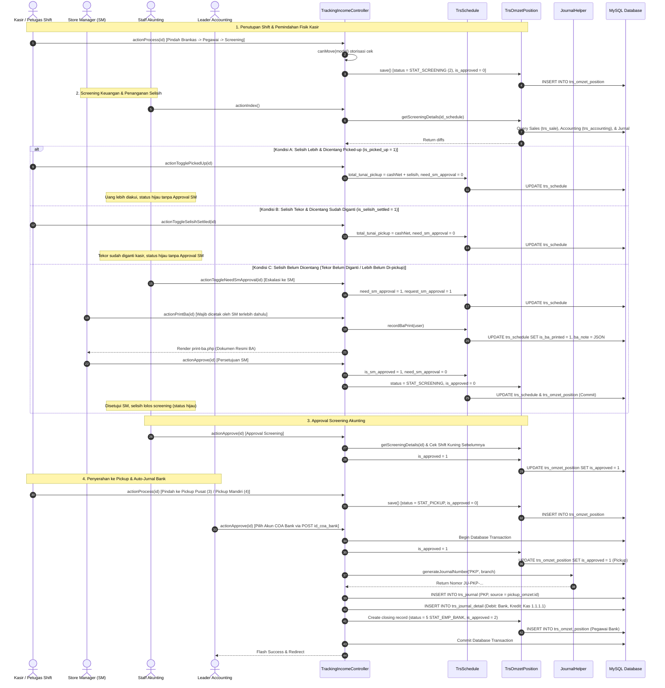
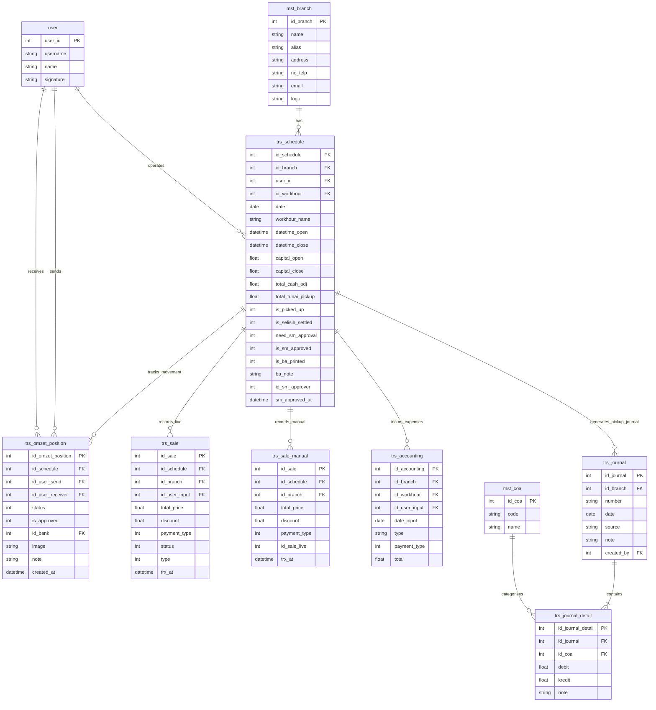

# DOKUMENTASI LENGKAP: MODUL TRACKING INCOME & SIKLUS PENDAPATAN SHIFT

Dokumentasi ini menyajikan analisis menyeluruh dari controller `app\controllers\report\TrackingIncomeController`, model-model terkait (`TrsOmzetPosition`, `TrsSchedule`, `TrsSale`, `TrsAccounting`, `TrsJournal`, `MstCoa`), alur kerja pengguna secara mendalam, pemetaan data response/view, diagram alur sistem, hingga transaksi database (ACID).

---

## 1. Peta Aktor & Peran Pengguna (Role & Responsibility Matrix)

| Aktor / Peran | Tanggung Jawab Utama dalam Modul |
| :--- | :--- |
| **Kasir (Cashier)** | Menghitung fisik modal tutup saat tutup shift, memilih penempatan uang awal (Brankas atau langsung ke Pegawai), mengganti tekor kas, atau mengonfirmasi uang lebih. |
| **Pegawai / Kurir Cabang** | Memegang uang transit, melakukan serah terima fisik dengan bukti foto/kamera, memindahkan status omzet ke tahap berikutnya. |
| **Staff Akunting (Screening)** | Memeriksa rekonsiliasi pembukuan (riwayat penjualan vs jurnal vs fisik), meminta eskalasi persetujuan SM jika ada selisih, menyetujui tahap Screening Keuangan. |
| **Store Manager (SM)** | Memeriksa alasan selisih kasir, **mencetak dokumen resmi Berita Acara (BA)** pertama kali, dan menyetujui selisih shift agar proses dapat dilanjutkan oleh Akunting. |
| **Leader Accounting** | Memvalidasi total uang yang di-pickup, mengedit nominal pickup jika ada penyesuaian fisik, memilih akun Bank tujuan, dan menyetujui setoran bank (otomasi penerbitan Jurnal Umum PKP). |
| **Leader Finance / Super Admin** | Memiliki wewenang bypass otorisasi (`canMove`), hak akses lintas cabang, dan wewenang mengoreksi `total_cash` jika diperlukan. |

---

## 2. Alur Kronologis End-to-End Aktivitas User (User Journey)

### Tahap 1: Kasir Menutup Shift (Inisiasi Awal Data)
* **Lokasi Fitur**: Menu Kasir &rarr; Tutup Kasir (`ShiftController::actionClose`).
* **Aktivitas yang dilakukan Kasir**:
  1. Menghitung uang fisik di laci kasir dan menginput **Kas Modal Tutup** (`capital_close`).
  2. Menentukan penempatan uang fisik kasir:
     * **Opsi A (Simpan di Brankas)**: Tidak memilih pegawai penerima &rarr; Sistem otomatis membuat record posisi awal: `status = 0 (STAT_BRANGKAS)`.
     * **Opsi B (Langsung Serahkan ke Pegawai/Kurir)**: Memilih nama pegawai di dropdown `id_omzet_receiver` &rarr; Sistem otomatis membuat record: `status = 1 (STAT_EMPLOYEE)` atas nama pegawai tersebut.
  3. Mengisi catatan tutup shift (jika ada selisih atau catatan khusus).
  4. Klik tombol **Tutup Shift**.

### Tahap 2: Pemindahan Fisik & Serah Terima Uang (`actionProcess`)
* **Lokasi Fitur**: Menu Laporan &rarr; Tracking Pendapatan &rarr; Tombol Pensil **Update / Proses**.
* **Siapa yang melakukan**: Pemegang uang saat ini (Kasir, Kurir, atau SM cabang).
* **Aktivitas yang dilakukan Pengguna**:
  1. Memilih **Posisi Pendapatan Terbaru**:
     * Dari *Brankas* &rarr; pilih *Pegawai*.
     * Dari *Pegawai* &rarr; pilih *Screening Keuangan*.
  2. Jika posisi baru adalah *Pegawai*, memilih nama **Pegawai Penerima** di dropdown. (Jika tujuan *Screening Keuangan*, dropdown otomatis disembunyikan karena uang diserahkan ke sistem pusat).
  3. Mengambil **Bukti Foto Serah Terima**:
     * **Mode Upload**: Memilih file gambar dari galeri HP/laptop.
     * **Mode Kamera**: Memilih opsi *"Ambil Kamera"*, browser meminta izin webcam &rarr; klik tombol *"Ambil Foto"*, hasil foto langsung di-convert menjadi data URL JPEG.
  4. Mengetik **Catatan** serah terima.
  5. Klik tombol **Simpan**.

### Tahap 3: Penanganan Selisih Fisik Kasir (Interaksi di Grid Index)
Ketika uang berada pada posisi `Screening Keuangan`, tabel menampilkan kolom **Selisih (Shift)**. Pengguna melakukan salah satu dari 3 tindakan berikut:

#### Tindakan A: Kasir Mengonfirmasi Uang Lebih (Surplus > 0)
* Uang kasir fisik lebih banyak daripada catatan penjualan.
* **Aktivitas**: Kasir / staf mengklik ikon kotak centang di samping label **Picked-up** (`actionTogglePickedUp`).
* **Efek Langsung**: Ikon berubah menjadi centang hijau `Picked-up [v]`, nilai uang lebih otomatis ditambahkan ke setoran pickup (`total_tunai_pickup = cashNet + selisih`), dan status menjadi hijau **tanpa perlu persetujuan SM**.

#### Tindakan B: Kasir Mengganti Uang Tekor (Minus < 0)
* Uang kasir fisik kurang (tekor).
* **Aktivitas**: Kasir menyerahkan uang pribadi sebagai pengganti tekor ke laci kasir, lalu mengklik ikon kotak centang di samping label **Sudah Diganti** (`actionToggleSelisihSettled`).
* **Efek Langsung**: Ikon berubah menjadi centang hijau `Sudah Diganti [v]`, uang setoran pickup kembali utuh, dan status menjadi hijau **tanpa perlu persetujuan SM**.

#### Tindakan C: Eskalasi ke Store Manager (Jika Selisih Belum Diselesaikan)
* Jika kasir belum mengganti uang tekor atau uang lebih belum di-pickup:
* **Aktivitas Staff Akunting**:
  1. Melihat tombol Approve berwarna kuning (*Kasir Minus Belum Diganti* atau *Kelebihan Belum Ditandai Picked-up*).
  2. Mengklik ikon centang **Approve SM** (`actionToggleNeedSmApproval`).
  3. Muncul badge kuning: `Menunggu Persetujuan SM`. Pada saat ini, shift terkunci dan tidak bisa diapprove oleh Akunting sebelum SM bertindak.

### Tahap 4: Tindakan Store Manager atas Selisih Shift
Ketika shift berstatus `Menunggu Persetujuan SM`:
* **Aktivitas Store Manager (SM)**:
  1. **Mencetak Berita Acara (Wajib Pertama Kali)**:
     * SM melihat tombol printer berwarna kuning: *"Cetak Berita Acara (Wajib dicetak sebelum approval SM)"*.
     * SM mengklik tombol tersebut (`actionPrintBa`).
     * Sistem membuka dokumen resmi Berita Acara Selisih Kas lengkap dengan logo cabang, rincian modal buka, penjualan tunai, pengeluaran kasir, nominal selisih, alasan tertulis kasir, tanda tangan kasir, dan watermark audit `[ ASLI ]`.
     * Browser otomatis memunculkan dialog `window.print()` untuk dicetak fisik/PDF.
     * Sistem otomatis mengubah flag `is_ba_printed = 1`.
  2. **Menyetujui Selisih Shift**:
     * Setelah Berita Acara dicetak, tombol centang hijau **Approve SM** menjadi aktif.
     * SM mengklik tombol centang hijau `actionApprove`.
     * Muncul konfirmasi browser: *"Apakah Anda yakin ingin menyetujui selisih shift ini sebagai SM?"*.
     * SM klik **OK**.
     * Sistem mencatat `is_sm_approved = 1`, tanda tangan digital SM terpasang di BA, dan status dikembalikan ke tahap Screening (`is_approved = 0`) dengan keterangan hijau: `Disetujui SM`.

### Tahap 5: Verifikasi & Approval oleh Tim Akunting
* **Siapa yang melakukan**: Staff Akunting (`Role::isFinancialScreening()`).
* **Aktivitas yang dilakukan Pengguna**:
  1. **Membaca Rincian Rekonsiliasi**: Hover kursor ke tombol centang hijau/kuning untuk melihat floating tooltip (Total Journal, Tunai History, Selisih History, Omzet History).
  2. **Mengecek Riwayat Shift**: Mengklik tombol biru **Riwayat Shift** (`fa-history`) untuk melihat modal popup (`actionShiftDetail`) yang merinci penjualan kasir per tipe pembayaran, diskon, piutang, dan running rate.
  3. **Mengecek Jurnal Terkait**: Mengklik tombol buku **Jurnal Umum** (`fa-book`) untuk membuka tab baru pembukuan jurnal shift tersebut.
  4. **Eksekusi Approval Screening**:
     * Jika tooltip sudah berstatus hijau (*Sesuai* atau *Disetujui SM*), Akunting mengklik tombol **Approve**.
     * Sistem memvalidasi apakah ada shift sebelum tanggal/jam ini pada cabang tersebut yang masih kuning. Jika ada, sistem menampilkan alert peringatan agar menyelesaikan shift sebelumnya terlebih dahulu.
     * Jika semua valid, record screening disetujui (`is_approved = 1`).

### Tahap 6: Penyerahan ke Kurir / Pickup
* **Siapa yang melakukan**: Kasir / Petugas Cabang.
* **Aktivitas yang dilakukan Pengguna**:
  1. Setelah tahap Screening berstatus `Approved`, tombol **Update / Proses** kembali aktif.
  2. Klik tombol **Update / Proses** (`actionProcess`).
  3. Memilih opsi posisi:
     * **Pickup Pusat**: Jika uang diambil oleh kurir/petugas pusat (sistem otomatis mengisi penerima ke ID `702`).
     * **Pickup Mandiri**: Jika cabang menyetorkan sendiri ke bank.
  4. Mengambil foto bukti uang fisik/serah terima dengan kurir.
  5. Klik **Simpan**.

### Tahap 7: Approval Leader Accounting & Penjurnalan Otomatis ke Bank
* **Siapa yang melakukan**: Leader Accounting (`Role::isLeaderAccounting()`).
* **Aktivitas yang dilakukan Pengguna**:
  1. **Memeriksa Kolom "Total Tunai Pickup"**: Memastikan nominal uang tunai yang akan disetor ke bank sudah sesuai. *(Opsional: jika uang tunai fisik yang diterima berbeda, pengguna dapat mengklik angka nominal untuk inline edit via modal)*.
  2. **Eksekusi Approval Setoran Bank**:
     * Mengklik tombol hijau **Approve Leader** (`btn-approve-leader`).
     * Muncul modal popup: **Pilih Akun Bank (Shift: ...)**.
     * Dropdown otomatis memprioritaskan akun bank operasional cabang tersebut (misal: BCA, BSI, Mandiri, BRI, BNI).
     * Leader Accounting memilih akun bank tujuan setoran, lalu klik tombol **Simpan & Approve**.
  3. **Hasil Akhir Sistem**:
     * Sistem mengunci status pickup menjadi `Approved`.
     * Sistem otomatis menerbitkan Jurnal Umum `JU-PKP-...` (Debit Bank vs Kredit Kas Cabang `1.1.1.1`).
     * Sistem otomatis menyisipkan record akhir: `Pegawai Bank (5)` dengan status hijau `Approved (2)`.
     * Tombol proses hilang karena siklus pelacakan uang shift telah **selesai secara sempurna**.

---

## 3. Diagram Alur Transisi Status (Flowchart)

File `.mmd` tersedia di: `docs/tracking_income_flow.mmd`

```mermaid
flowchart TD
    StartKasir([Kasir Selesai Shift]) --> TutupShift["ShiftController::actionClose:
    Kasir Input Modal Tutup (capital_close)"]
    
    TutupShift --> PilihPenempatan{"Pilih Penempatan Uang?"}
    PilihPenempatan -->|"Simpan di Brankas (id_omzet_receiver kosong)"| Brankas["Posisi: Brankas (0)
    (Uang disimpan di brankas kasir)"]
    PilihPenempatan -->|"Serahkan ke Pegawai (id_omzet_receiver diisi)"| PegawaiDirect["Posisi: Pegawai (1)
    (Uang langsung dipegang kurir/staf)"]
    
    Brankas -->|actionProcess + Foto Bukti/Kamera| Pegawai["Posisi: Pegawai (1)
    (Serah terima ke staf/kurir cabang)"]
    PegawaiDirect --> Pegawai
    Pegawai -->|actionProcess + Foto Bukti/Kamera| Screening["Posisi: Screening Keuangan (2)
    (Laporan & uang diserahkan ke Akunting)"]
    
    Screening --> CekSelisih{Kondisi Selisih Kasir}
    
    CekSelisih -->|"Selisih = 0 (Pas/Sesuai)"| SiapApprove["Status Hijau: Siap Disetujui Akunting"]
    
    CekSelisih -->|"Selisih > 0 (Uang Lebih)"| CekPickedUp{"Dicentang Picked-up?"}
    CekPickedUp -->|"Ya (is_picked_up = 1)"| SettledSurplus["actionTogglePickedUp:
    total_tunai_pickup = totalCashNet + selisih
    need_sm_approval = 0
    (Uang lebih diakui, TANPA Approval SM)"]
    SettledSurplus --> SiapApprove
    CekPickedUp -->|"Tidak (is_picked_up = 0)"| SelisihGantungSurplus["Status Kuning:
    Kelebihan Uang Kasir Belum Ditandai Picked-up"]
    
    CekSelisih -->|"Selisih < 0 (Uang Tekor)"| CekSettled{"Dicentang Sudah Diganti?"}
    CekSettled -->|"Ya (is_selisih_settled = 1)"| SettledMinus["actionToggleSelisihSettled:
    total_tunai_pickup = totalCashNet
    need_sm_approval = 0
    (Kasir ganti tekor, TANPA Approval SM)"]
    SettledMinus --> SiapApprove
    CekSettled -->|"Tidak (is_selisih_settled = 0)"| SelisihGantungMinus["Status Kuning:
    Kasir Minus Belum Diganti"]
    
    SelisihGantungSurplus --> EskalasiSM["actionToggleNeedSmApproval:
    Staff Akunting mengeskalasikan ke SM
    (need_sm_approval = 1, request_sm_approval = 1)"]
    SelisihGantungMinus --> EskalasiSM
    
    EskalasiSM --> PrintBA["actionPrintBa:
    Store Manager (SM) Wajib Cetak Berita Acara (BA)
    (is_ba_printed = 1, Watermark ASLI, Audit ba_note)"]
    PrintBA --> ApproveSM["actionApprove (Oleh SM):
    is_sm_approved = 1, need_sm_approval = 0
    (Status kembali ke Screening, is_approved = 0)"]
    ApproveSM --> SiapApprove
    
    SiapApprove --> CekRantaiShift{"Cek Shift Sebelumnya
    di Cabang & Bulan Ini?"}
    CekRantaiShift -->|"Ada shift sebelumnya masih Kuning"| TolakApprove["Peringatan: Selesaikan shift
    sebelumnya terlebih dahulu!"]
    CekRantaiShift -->|"Shift sebelumnya aman (Hijau)"| ApproveScreening["actionApprove (Oleh Staff Akunting):
    is_approved = 1 (Screening Selesai)"]
    
    ApproveScreening -->|actionProcess + Foto Bukti/Kamera| PilihanPickup{"Pilih Jalur Pickup"}
    PilihanPickup -->|"Pickup Pusat (Kurir Pusat)"| PickupPusat["Posisi: Pickup Pusat (3)
    (id_user_receiver auto 702, is_approved = 0)"]
    PilihanPickup -->|"Pickup Mandiri (Cabang Setor Sendiri)"| PickupMandiri["Posisi: Pickup Mandiri (4)
    (id_user_receiver NULL, is_approved = 0)"]
    
    PickupPusat --> ReviewLeader["Leader Accounting Review:
    Cek Total Tunai Pickup (Bisa inline edit)"]
    PickupMandiri --> ReviewLeader
    
    ReviewLeader --> ModalBank["actionApprove:
    Buka Modal & Pilih Akun COA Bank Tujuan (1.1.1.x)"]
    
    ModalBank --> ExecuteApprovalLeader["Simpan & Approve Leader:
    Begin Database Transaction"]
    
    ExecuteApprovalLeader --> UpdatePickup["UPDATE trs_omzet_position SET is_approved = 1"]
    ExecuteApprovalLeader --> GenJournal["JournalHelper::generateJournalNumber('PKP', branch):
    INSERT INTO trs_journal (JU-PKP-..., source = pickup_omzet:id)"]
    ExecuteApprovalLeader --> InsertDetailJurnal["INSERT INTO trs_journal_detail:
    - Debit: Akun Bank Terpilih
    - Kredit: Kas Utama Cabang (1.1.1.1)"]
    ExecuteApprovalLeader --> InsertPegawaiBank["INSERT INTO trs_omzet_position:
    Posisi: Pegawai Bank (5), is_approved = 2"]
    
    InsertPegawaiBank --> CommitDB["Commit Transaction:
    Siklus Tracking Selesai Sempurna"]
    CommitDB --> Selesai([Uang Masuk Rekening Bank Perusahaan])
```

---

## 4. Diagram Sequence: Alur Data Antar-Komponen

File `.mmd` tersedia di: `docs/tracking_income_sequence.mmd`

---

## 5. Diagram ERD Database Ringkas

File `.mmd` tersedia di: `docs/tracking_income_erd.mmd`

---

## 6. Tabel Pemetaan Atribut Data Response & View

Format standar: **Field Output | Source Class/Method | Database Table & Column | Logic/Transformation**

### A. Halaman Utama: Grid Index (`actionIndex` &rarr; `views/report/tracking-income/index.php`)

| Field Output | Source Class/Method | Database Table & Column | Logic/Transformation |
| :--- | :--- | :--- | :--- |
| **Shift** | `TrackingIncomeController::actionIndex()` | `trs_schedule.workhour_name`, `trs_schedule.workhour_start`, `trs_schedule.workhour_end` | Digabung dan diformat tanggal/jam menggunakan `formatter->asDatetime()`: `workhour_name (start - end)`. |
| **Kasir** | `TrackingIncomeController::actionIndex()` | `user.name` (aliased as `user_cashier`) via `trs_schedule.user_id = user.user_id` | Menampilkan nama kasir yang bertugas pada shift tersebut. |
| **Posisi Pendapatan (Status)** | `TrsOmzetPosition::getStatus()`, `TrackingIncomeController::actionIndex()` | `trs_omzet_position.status`, `trs_omzet_position.id_user_receiver` &rarr; `user.name`, `trs_schedule.need_sm_approval`, `trs_schedule.is_sm_approved` | Diambil dari record posisi terakhir (`num = 1`). Dikonversi ke label status (Brankas, Pegawai, Screening, Pickup, Bank). Jika `need_sm_approval = 1` dan belum disetujui SM, ditambahkan badge `Menunggu Persetujuan SM`. Jika ada penerima, nama penerima digabungkan. |
| **Total Omzet** | `TrackingIncomeController::actionIndex()` | `trs_sale.total_price`, `trs_sale_manual.total_price` | `SUM(s.total_price)` dari `trs_sale` (status aktif/piutang, tipe sale/receipt) di-`UNION ALL` dengan `trs_sale_manual` (`id_sale_live IS NULL`), di-group per `id_schedule`. Diformat desimal. |
| **Total Tunai** | `TrackingIncomeController::actionIndex()` | `trs_schedule.total_cash_adj`, `trs_sale.payment_type`, `trs_sale.total_price`, `trs_sale_manual.payment_type`, `trs_sale_manual.total_price`, `trs_accounting.total` | `GREATEST(0, COALESCE(NULLIF(s.total_cash_adj, 0), so.total_cash) - COALESCE(ex.total_expense, 0))`. Mengambil penjualan cash (`payment_type = 1` atau null), diprioritaskan nilai manual `total_cash_adj`, lalu dikurangi pengeluaran kas shift (`trs_accounting`). |
| **Total Non Tunai** | `TrackingIncomeController::actionIndex()` | `trs_sale.payment_type`, `trs_sale.total_price`, `trs_sale_manual.payment_type`, `trs_sale_manual.total_price` | `COALESCE(SUM(CASE WHEN payment_type != 1 AND payment_type IS NOT NULL THEN total_price ELSE 0 END), 0)` dari `trs_sale` dan `trs_sale_manual`. |
| **Selisih (Shift)** | `TrsOmzetPosition::calculateSelisih()` | `trs_schedule.capital_close`, `trs_schedule.capital_open`, `so.total_cash` (`original_total_cash`), `ex.total_expense` (`trs_accounting`), `trs_schedule.is_picked_up`, `trs_schedule.is_selisih_settled`, `trs_schedule.is_sm_approved` | Formula: `capital_close - (original_total_cash + capital_open - total_expense)`.  Interaktif: Menampilkan tombol toggle `Picked-up` (jika surplus > 0), `Sudah Diganti` (jika tekor < 0), atau `Approve SM` (jika ada selisih di tahap Screening). |
| **Total Tunai Pickup** | `TrackingIncomeController::actionIndex()`, `views/report/tracking-income/index.php` | `trs_schedule.total_tunai_pickup`, `trs_schedule.is_picked_up`, `trs_schedule.is_selisih_settled`, `total_cash` | Jika `total_tunai_pickup > 0`, gunakan nilai kolom tersebut. Jika 0, hitung otomatis: `max(0, total_cash + adjustment)` di mana selisih lebih dihitung jika `is_picked_up = 1` dan selisih kurang terpotong kecuali jika `is_selisih_settled = 1`. Dilengkapi modal inline edit. |
| **Tgl Pemindahan** | `TrackingIncomeController::actionIndex()` | `trs_omzet_position.created_at` (terakhir) | Tanggal dan jam pembuatan record `trs_omzet_position` baris terakhir. Diformat datetime. |
| **Bukti** | `TrackingIncomeController::actionIndex()`, `UploadForm::getPath()` | `trs_omzet_position.image` (terakhir) | Diambil dari path foto upload / webcam snapshot. Dirender sebagai gambar thumbnail dengan fitur hover fullscreen. |
| **Catatan** | `TrackingIncomeController::actionIndex()` | `trs_omzet_position.note` | `SELECT GROUP_CONCAT(DISTINCT note SEPARATOR "\n") FROM trs_omzet_position WHERE id_schedule = s.id_schedule AND note IS NOT NULL AND note != ""` (Menggabungkan seluruh catatan perpindahan pada shift tersebut). |
| **Tooltip Screening (Tombol Approve)** | `TrsOmzetPosition::getScreeningDetails()` | `trs_sale`, `trs_sale_manual`, `trs_journal`, `trs_journal_detail`, `trs_accounting` | Membandingkan 4 komponen: Kas Penjualan Riwayat Shift vs Debit Jurnal Tunai, Tunai Riwayat vs Tunai Tracking, Selisih Riwayat vs Selisih Tracking, dan Omzet Riwayat vs Omzet Tracking. Tombol berwarna kuning jika ada selisih, hijau jika *match*. |

---

### B. Halaman Detail & Partial (`actionView` &rarr; `view.php` & `_partial.php`)

| Field Output | Source Class/Method | Database Table & Column | Logic/Transformation |
| :--- | :--- | :--- | :--- |
| **Cabang** | `TrsSchedule::getBranch()` | `trs_schedule.id_branch` &rarr; `mst_branch.name` | Relasi active record `schedule->branch->name`. |
| **Shift** | `views/report/tracking-income/_partial.php` | `trs_schedule.workhour_name`, `trs_schedule.workhour_start`, `trs_schedule.workhour_end` | Gabungan nama shift dan jam mulai - jam selesai. |
| **Nama Kasir** | `TrsSchedule::getUser()` | `trs_schedule.user_id` &rarr; `user.name` | Relasi active record `schedule->user->name`. |
| **Total Pendapatan** | `TrackingIncomeController::getOmset()` | `trs_sale.total_price`, `trs_sale_manual.total_price` | `so.total_omzet` dari subquery omzet gabungan penjualan live dan manual. Diformat integer rupiah. |
| **Total Tunai** | `TrackingIncomeController::getOmset()` | `trs_schedule.total_cash_adj`, `trs_sale.total_price`, `trs_sale_manual.total_price` | `COALESCE(NULLIF(s.total_cash_adj, 0), so.total_cash)`. Disertai tombol edit modal `btn-edit-total-cash` untuk role Leader Finance/Super. |
| **Total Non Tunai** | `TrackingIncomeController::getOmset()` | `trs_sale.payment_type`, `trs_sale_manual.payment_type` | `COALESCE(so.total_non_cash, 0)`. Diformat integer. |
| **Posisi Pendapatan Saat Ini** | `views/report/tracking-income/_partial.php` | `trs_omzet_position.status`, `trs_omzet_position.is_approved`, `trs_schedule.need_sm_approval`, `trs_schedule.is_sm_approved`, `user.name` | String label status ditambah label badge approval (`Waiting Staff Approval` / `Waiting Leader Approval` / `Approved` / `Menunggu Persetujuan SM`). |
| **Tabel History: Tgl Pindah** | GridView `views/report/tracking-income/view.php` | `trs_omzet_position.created_at` | Diformat datetime: Tanggal pencatatan pergerakan. |
| **Tabel History: User (Pemberi)** | `TrsOmzetPosition::getUserGive()` | `trs_omzet_position.id_user_send` &rarr; `user.name` | Nama pegawai yang menyerahkan uang. |
| **Tabel History: Status & Penerima** | `views/report/tracking-income/view.php` | `trs_omzet_position.status`, `trs_omzet_position.is_approved`, `trs_omzet_position.id_user_receiver` &rarr; `user.name` | Menampilkan label posisi, badge status approval baris tersebut, dan nama penerima jika status penyerahan pegawai. |
| **Tabel History: Bukti** | `UploadForm::getPath()` | `trs_omzet_position.image` | Tag `` bukti foto serah terima dengan link data-lightbox. |

---

### C. Halaman Form Pemindahan Posisi (`actionProcess` &rarr; `process.php`)

| Field Output | Source Class/Method | Database Table & Column | Logic/Transformation |
| :--- | :--- | :--- | :--- |
| **Header & Ringkasan Shift** | View partial `_partial.php` | Sama dengan Bagian B | Menampilkan ringkasan data shift dan total uang. |
| **Alert Persetujuan SM** | `TrsOmzetPosition::calculateSelisih()`, `trs_schedule.is_sm_approved` | `trs_schedule.capital_close`, `trs_schedule.capital_open`, `total_cash`, `trs_schedule.is_sm_approved` | Menampilkan alert hijau jika shift memiliki selisih dan telah disetujui SM beserta nominal selisihnya. |
| **Input: Posisi Pendapatan Terbaru** | Dynamic status array di `process.php` | Target simpan: `trs_omzet_position.status` | Menentukan opsi status selanjutnya:  - Brankas &rarr; Pegawai  - Pegawai &rarr; Screening Keuangan  - Screening &rarr; Pickup Pusat / Pickup Mandiri. |
| **Input: Pegawai Penerima** | `Account::getList()` | Target simpan: `trs_omzet_position.id_user_receiver` | Dropdown Select2 daftar user aktif pada cabang shift. Tersembunyi otomatis jika status Screening, Pickup Mandiri, atau Pegawai Bank. |
| **Input: Catatan** | Form input | Target simpan: `trs_omzet_position.note` | Textarea catatan penyerahan atau klarifikasi kasir. |
| **Input: Bukti (Kamera / File Upload)** | `UploadForm::loadImage()`, `Helper::saveImgDataUrl()` | Target simpan: `trs_omzet_position.image` | Mendukung upload berkas gambar atau snapshot langsung dari webcam browser (Canvas to DataURL). Disimpan di storage `uploads/omzet-position/`. |

---

### D. Berita Acara Selisih Kas (`actionPrintBa` &rarr; `print-ba.php`)

| Field Output | Source Class/Method | Database Table & Column | Logic/Transformation |
| :--- | :--- | :--- | :--- |
| **Kop Surat (Nama, Alamat, Telp, Email, Logo Cabang)** | `TrsSchedule::getBranch()`, `Helper::getBaseFile()` | `mst_branch.name`, `mst_branch.address`, `mst_branch.no_telp`, `mst_branch.email`, `mst_branch.logo` | Header kop surat resmi apotek cabang. |
| **Nomor Berita Acara** | `print-ba.php` | `trs_schedule.date`, `trs_schedule.id_schedule` | Formula string: `'BA-SELISIH/' . date('Ym', strtotime(date)) . '/' . str_pad(id_schedule, 5, '0', STR_PAD_LEFT)`. |
| **Waktu Pelaksanaan** | `date('D')` & `date('m')` mapping | `trs_schedule.date` | Dikonversi ke nama hari dan bulan bahasa Indonesia (contoh: *Senin tanggal 03 November 2026*). |
| **Nama Kasir** | `TrsSchedule::getUser()` | `trs_schedule.user_id` &rarr; `user.name` | Nama lengkap kasir yang menutup shift. |
| **Shift / Jam Kerja** | Active Record | `trs_schedule.workhour_name` | Nama jadwal jam kerja (Pagi/Siang/Malam). |
| **Waktu Buka / Tutup Shift** | Active Record | `trs_schedule.datetime_open`, `trs_schedule.datetime_close` | Diformat datetime WIB. |
| **1. Modal Buka** | Active Record | `trs_schedule.capital_open` | Kas uang modal kembalian awal kasir. |
| **2. Total Penjualan Tunai Shift** | `TrackingIncomeController::getOmset()` | `trs_sale`, `trs_sale_manual` (`payment_type = 1` atau null) | Total penerimaan penjualan tunai kasir selama jam shift. |
| **3. Total Pengeluaran Kasir** | SQL Query di `actionPrintBa()` | `trs_accounting.total` | `SUM(total)` dari `trs_accounting` di mana `type = 'debit'`, `payment_type = 0`, `id_branch`, `id_workhour`, `date_input`, `id_user_input`. |
| **4. Saldo Kas Seharusnya** | Kalkulasi di `print-ba.php` | `capital_open`, `total_cash`, `total_expense` | Formula: `(capital_open + total_cash - total_expense)`. |
| **5. Kas Modal Tutup Kasir** | Active Record | `trs_schedule.capital_close` | Uang tunai fisik yang dihitung kasir saat tutup kasir. |
| **6. SELISIH KAS** | `TrsOmzetPosition::calculateSelisih()` | `capital_close`, `saldoSeharusnya` | `capital_close - saldoSeharusnya`. Ditampilkan label: *Kekurangan Kas (Minus)*, *Kelebihan Kas (Surplus)*, atau *Sesuai (Tanpa Selisih)*. |
| **Total Non-Tunai & Omzet** | Subquery Omzet | `total_non_cash`, `total_omzet` | Catatan kaki rekapitulasi penjualan non-tunai dan omzet total. |
| **Keterangan / Alasan Selisih** | Active Record | `trs_omzet_position.note` atau `trs_schedule.omzet_note` | Alasan atau kronologi selisih yang dituliskan oleh kasir. |
| **Tanda Tangan Kasir** | `user->getSignature()` | `user.signature`, `user.name` | Tanda tangan digital kasir (gambar PNG) dan nama jelas. |
| **Tanda Tangan Store Manager** | `MstSetting::getSm()`, `smUser->getSignature()` | `mst_setting.value`, `user.signature`, `trs_schedule.is_sm_approved` | Mencari Store Manager cabang melalui setting peran. Tanda tangan digital SM otomatis muncul jika `is_sm_approved = 1`. |
| **Audit Cetak (Asli / Salinan)** | `TrsSchedule::recordBaPrint()` | `trs_schedule.ba_note` (JSON), `trs_schedule.is_ba_printed` | Menampilkan watermark status `[ ASLI ]` saat pertama kali dicetak oleh SM, atau `[ COPY ]` (Salinan ke-n) beserta nama user pencetak dan timestamp lengkap. |

---

### E. Modal Rekap Riwayat Shift (`actionShiftDetail` &rarr; `@app/views/trx/shift/print.php`)

| Field Output | Source Class/Method | Database Table & Column | Logic/Transformation |
| :--- | :--- | :--- | :--- |
| **Username & Cabang** | Active Record | `trs_schedule.user_id` &rarr; `user.username`, `trs_schedule.id_branch` &rarr; `mst_branch.name` | Identitas kasir dan cabang. |
| **Waktu Shift & Buka** | Active Record | `trs_schedule.workhour_name`, `workhour_start`, `workhour_end`, `datetime_open` | Jadwal shift dan waktu real kasir membuka register. |
| **Reopen Shift (jika ada)** | Active Record | `trs_schedule.reopen_by` &rarr; `user.name`, `trs_schedule.reopen_at`, `trs_schedule.extend_end` | Menampilkan nama supervisor pembuka shift dan batas waktu perpanjangan shift. |
| **Total Pendapatan Shift** | `TrackingIncomeController::actionShiftDetail()` | `trs_sale.total_price`, `trs_sale_manual.total_price` | Akumulasi penerimaan seluruh pembayaran shift tersebut. |
| **Pendapatan Per Karyawan & Tipe Pembayaran** | SQL Query di `actionShiftDetail()` | `user.name`, `trs_sale.payment_type`, `trs_sale.total_price`, `trs_sale_manual.payment_type`, `trs_sale_manual.total_price` | Rincian breakdown omzet per kasir dan metode pembayaran (Tunai Live/Manual, EDC Debit, QRIS, Transfer, dsb.). |
| **Modal Buka** | Active Record | `trs_schedule.capital_open` | Uang modal awal kasir. |
| **Pengeluaran** | SQL Query di `actionShiftDetail()` | `trs_accounting.total` | `SUM(total)` dari `trs_accounting` (tipe debit dan tunai pada shift tersebut). |
| **Diskon Live & Manual** | SQL Query di `actionShiftDetail()` | `trs_sale.discount`, `trs_sale_manual.discount` | Total potongan harga/diskon transaksi live dan manual. |
| **Piutang** | SQL Query di `actionShiftDetail()` | `trs_sale.total_price`, `trs_sale_manual.total_price` | Total nilai penjualan berstatus piutang (`status = 2`). |
| **Modal Tutup** | Active Record | `trs_schedule.capital_close` | Total kas modal akhir shift. |
| **Selisih** | Formula di `print.php` | `capital_close`, `Tunai Live`, `Tunai Manual`, `capital_open`, `expense`, `totalPiutang` | `capital_close - ((Tunai Live + Tunai Manual) + capital_open - expense) + totalPiutang`. |
| **Jumlah Transaksi & Manual** | Query `count()` di `actionShiftDetail()` | `trs_sale.id_sale`, `trs_sale_manual.id_sale` | Total struk transaksi yang diterbitkan selama shift. |
| **Buying Power** | Formula di `print.php` | `income_shift`, `totalCountTrx` | Rata-rata nominal per transaksi: `income_shift / totalCountTrx`. |
| **Running Rate** | Formula di `actionShiftDetail()` | `trs_plan_target.daily_omzet`, `trs_sale.total_price` | Persentase laju pencapaian target omzet bulanan berjalan: `((totalOmzetBulanIni * totalHariBulan / hariKe) * 100 / monthlyOmzetTarget)`. |
